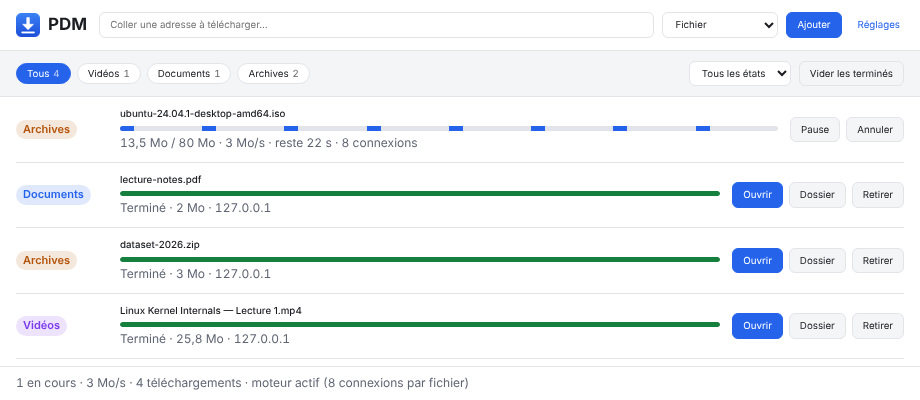
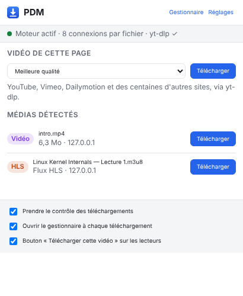
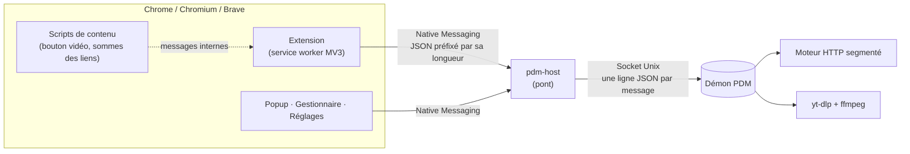

<div align="center">


# PDM — Gestionnaire de téléchargements pour Chrome sous Linux

**Téléchargements multi-connexions, prise de contrôle du navigateur et vidéos en un clic,
dans l'esprit d'Internet Download Manager — pour Chrome, Chromium, Brave, Edge et Vivaldi sous Linux.**

[](https://github.com/dbvrnylh/pdm-download-manager/actions/workflows/ci.yml)
[](LICENSE)


[English](README.md) · [Journal des versions](CHANGELOG.md)

<picture>
  <source media="(prefers-color-scheme: dark)" srcset="docs/screenshots/manager-dark.png">
  
</picture>

</div>

## Points forts

- **Téléchargements accélérés.** Jusqu'à 32 connexions par fichier, avec segmentation dynamique : une connexion
  qui a fini coupe en deux le segment qui finirait le dernier et en prend la moitié ; une connexion qui traîne est
  rouverte. Aucune ne reste inactive, aucune ne fait attendre les autres.
- **Prise de contrôle sans risque.** Le moteur fait d'abord une requête d'essai ; si le serveur refuse (page de
  connexion, lien à usage unique…), Chrome continue normalement. Aucun téléchargement n'est perdu.
- **Pause, reprise, résistance.** La progression est sauvegardée segment par segment : reprise après une coupure
  réseau, un redémarrage du navigateur ou du PC. Le moteur continue navigateur fermé.
- **Fichiers vérifiés.** Le SHA-256 de chaque fichier est calculé pendant le téléchargement et comparé à la somme
  affichée à côté du lien (GitHub, distributions Linux…) ou annoncée par le serveur : un fichier abîmé n'est jamais
  livré. **Vérifier…** compare un fichier terminé à la somme que tu colles.
- **Plusieurs serveurs à la fois.** Quand le site annonce ses miroirs (Metalink/HTTP, comme LibreOffice ou Kiwix),
  même pour un téléchargement pris au navigateur, chaque connexion va au serveur le plus rapide du moment : quand l'origine limite ou ralentit, les miroirs prennent le
  relais, et un miroir en panne, lent ou qui sert un autre fichier est écarté. Seulement quand une somme permet de
  tout vérifier. Avec les sommes de chaque morceau (`.meta4`), un morceau faux est retéléchargé seul.
- **Vidéos en un clic.** Un bouton « Télécharger cette vidéo » apparaît sur les lecteurs ; la popup liste les
  médias détectés ; YouTube et des centaines de sites passent par [yt-dlp](https://github.com/yt-dlp/yt-dlp),
  avec choix de la qualité (meilleure, 1080p, 720p, 480p, MP3). Les flux HLS/DASH sont assemblés en un seul MP4.
- **Rangement automatique** dans `Videos/`, `Musique/`, `Documents/`, `Archives/`, `Programmes/`, `Images/`,
  et `Generique/` pour le reste, selon l'extension ; extensions et nom de dossier modifiables pour chaque catégorie. File d'attente, notifications du bureau, clic droit « Télécharger avec PDM ».
- **Ta file, à ta façon.** Fais glisser les téléchargements en attente dans l'ordre où ils doivent partir, donne à
  un téléchargement son propre nombre de connexions ou sa vitesse maximale (même en cours), fais extraire les
  archives terminées à côté d'elles, lance ton propre programme après chaque téléchargement, et mets le PC en
  veille ou éteins-le quand tout est fini.
- **Torrents et liens magnet.** Clique un lien magnet ou un lien `.torrent`, ou ouvre un fichier `.torrent` que tu
  as déjà : PDM télécharge ce qu'il décrit, et [aria2](https://aria2.github.io/) fait le travail BitTorrent en
  arrière-plan (`sudo apt install aria2`).
- **Regarder pendant le téléchargement.** **Lire**, sur une vidéo ou une musique encore en cours, qu'elle vienne
  d'un lien ou d'un torrent, l'ouvre dans ton lecteur (VLC, mpv…) : le début se lit tout de suite, un saut en avant
  y envoie une connexion, et les connexions se relaient devant la lecture quand une seule va moins vite que la vidéo.
- **Parle aria2.** AriaNg, les scripts aria2 et les extensions qui envoient leurs liens à aria2 peuvent piloter PDM
  par la même API JSON-RPC : en local uniquement, avec un secret, et coupée tant que tu ne l'actives pas.
- **Rien à installer** pour le moteur : bibliothèque standard de Python uniquement. Thèmes clair et sombre.

## Sommaire

- [Démarrage rapide](#démarrage-rapide)
- [Utilisation](#utilisation)
- [Fonctionnement](#fonctionnement)
- [Réglages](#réglages)
- [Questions fréquentes](#questions-fréquentes)
- [Dépannage](#dépannage)
- [Vie privée et sécurité](#vie-privée-et-sécurité)
- [Développement](#développement)
- [Feuille de route](#feuille-de-route)
- [Désinstallation](#désinstallation)

## Démarrage rapide

**Prérequis :** Linux, un navigateur basé sur Chromium (Chrome 116 ou plus), Python 3.10 ou plus.
Recommandé : `ffmpeg` (fusion audio + vidéo, MP3) et `libnotify-bin` (notifications).

```bash
git clone https://github.com/dbvrnylh/pdm-download-manager.git
cd pdm-download-manager
./install.sh            # sans sudo : tout s'installe dans ton dossier personnel
```

L'installateur copie le moteur dans `~/.local/share/pdm`, le déclare auprès de chaque navigateur Chromium
trouvé, et propose d'installer la copie de yt-dlp de PDM, toujours à jour (réponds **oui**).

Ensuite, charge l'extension :

1. Ouvre `chrome://extensions` (`brave://extensions`, `edge://extensions`…).
2. Active le **Mode développeur**.
3. **Charger l'extension non empaquetée** → choisis le dossier `extension/` de ce dépôt.
4. Ouvre PDM → **Réglages** : tu dois lire **« Moteur PDM 2.0.4 actif »**.

Laisse le dépôt à sa place : le navigateur charge l'extension depuis ce dossier.

## Utilisation

| Je veux… | Comment |
|---|---|
| Télécharger un fichier | Clique le lien comme d'habitude : PDM le reprend et ouvre son gestionnaire. |
| Télécharger une vidéo | Survole le lecteur → **Télécharger cette vidéo** (dans ta qualité par défaut). |
| Choisir la qualité | Survole le lecteur → **▾** à côté du bouton → **Meilleure qualité**, **1080p**, **720p (moyenne)**, **480p (petite)** ou **Audio seul (MP3)**. Ou icône PDM → **Vidéo de cette page**. |
| Un média précis de la page | Icône PDM → **Médias détectés**, ou clic droit sur le lien → **Télécharger avec PDM**. |
| Ajouter une adresse à la main | Gestionnaire → coller l'adresse → **Fichier** ou **Vidéo de la page** → **Ajouter**. |
| Télécharger une liste de liens | Gestionnaire → **Importer une liste…**, ou `pdm-host add --file liens.txt`. Voir [ci-dessous](#télécharger-une-liste-de-liens). |
| Télécharger plus tard (la nuit) | Gestionnaire → **Plus tard** sur un téléchargement, ou la case **Plus tard** à l'import d'une liste, ou `pdm-host add --later URL`. Il n'avance que pendant la plage horaire des **Réglages** ; le reste part tout de suite. |
| Vérifier un fichier | Rien à faire quand la page affiche sa somme à côté du lien : PDM la relève au clic et vérifie le fichier. Sinon, gestionnaire → **Vérifier…** sur un téléchargement terminé → colle la somme du site (SHA-256, SHA-512, SHA-1 ou MD5). Pas celle que PDM affiche : comparé à lui-même, un fichier correspond toujours, et PDM la refuse. |
| Changer l'ordre de la file | Gestionnaire → **En cours** → fais glisser un téléchargement en attente à sa place. Ou **Options…** dessus → **En premier** / **En dernier**. |
| Limiter un téléchargement, ou lui donner plus de connexions | Gestionnaire → **Options…** dessus : connexions et vitesse maximale pour ce fichier seulement, appliquées tout de suite s'il est en cours (une vidéo : à son prochain démarrage). |
| Mettre en veille ou éteindre quand tout est fini | Gestionnaire → **À la fin : veille** ou **éteindre** (ou `pdm-host when-done suspend\|poweroff`). Quand plus rien ne se télécharge ni n'attend dans la file, un compte à rebours de 60 s apparaît avec **Annuler**, puis systemd met le PC en veille ou l'éteint. Une seule fois : le choix revient ensuite à « rien ». |
| Regarder une vidéo pendant son téléchargement | Gestionnaire → **Lire** dessus. Voir [ci-dessous](#lire-pendant-le-téléchargement). |
| Télécharger un torrent | Clique son lien magnet ou son lien `.torrent`, comme d'habitude ; ou colle le lien magnet dans le gestionnaire, ou `pdm-host add "magnet:?xt=…"`. Un fichier `.torrent` déjà sur ton disque : gestionnaire → **Ouvrir un .torrent…**, ou glisse-le sur le gestionnaire ou dans un onglet du navigateur, ou `pdm-host add fichier.torrent`. Il faut aria2 (`sudo apt install aria2`). Voir [ci-dessous](#torrents-et-liens-magnet). |
| Depuis le terminal | `~/.local/share/pdm/app/pdm-host add URL` (`--video` pour passer par yt-dlp, `--quality 720` pour la qualité, `--checksum sha-256=…` pour une somme attendue, comme aria2). |
| Piloter PDM depuis d'autres outils | Réglages → *Piloter PDM depuis d'autres outils*, ou `pdm-host rpc on` : l'API JSON-RPC compatible aria2, pour AriaNg et les scripts aria2. Voir [ci-dessous](#lapi-compatible-aria2). |

Si un site très protégé refuse le moteur, **Avec Chrome** relance le téléchargement dans le navigateur,
avec sa propre session.

<table>
  <tr>
    <td width="50%">
      <picture>
        <source media="(prefers-color-scheme: dark)" srcset="docs/screenshots/popup-dark.png">
        
      </picture>
    </td>
    <td width="50%">
      
      <br><br>
      <b>Popup</b> — état du moteur, vidéo de la page en un clic (avec choix de la qualité) et tous les médias
      détectés dans la page.
      <br><br>
      <b>Bouton vidéo</b> — apparaît au survol d'un lecteur, isolé dans un Shadow DOM fermé pour ne jamais
      déformer la page.
    </td>
  </tr>
</table>

### Télécharger une liste de liens

Pour récupérer beaucoup de fichiers d'un coup, prépare un fichier texte avec **un lien par ligne** :

```text
# Cours de réseau (les lignes qui commencent par # sont ignorées)
https://exemple.org/cours/chapitre-1.pdf
https://exemple.org/cours/chapitre-2.pdf

https://exemple.org/cours/annexes.zip
```

Les listes écrites pour aria2 (`aria2c -i`) marchent telles quelles : les miroirs d'un même fichier sur une ligne,
séparés par une tabulation ; ses options en dessous, en retrait ; et les séquences.

```text
https://exemple.org/fedora.iso	https://miroir.exemple/fedora.iso
  out=fedora-42.iso
  checksum=sha-256=…
  header=Authorization: Bearer …
https://exemple.org/photos/img[001-120].jpg
https://{dl1,dl2}.exemple.org/archive.zip
```

- Options suivies : `out`, `checksum`, `header` (répétable), `referer`, `user-agent`, `pause`, `split`,
  `max-connection-per-server`, `max-download-limit`, avec le même sens que dans l'[API JSON-RPC](#lapi-compatible-aria2).
  Celles qui disent comment télécharger (`max-tries`, `continue`…) sont laissées à PDM. `dir` et les options
  inconnues sont ignorées, et l'aperçu le dit : les fichiers vont dans le dossier de PDM, par catégorie.
- `[001-120]` donne un téléchargement par numéro (les zéros en tête fixent la largeur, `[0-100:5]` avance de 5 en
  5, `[a-z]` marche aussi) ; `{dl1,dl2}` donne des miroirs du même fichier, 4 au plus. Crochets et accolades non
  encodés sont interdits dans une adresse : un tel motif ne peut donc être qu'une séquence (une adresse IPv6 comme
  `[::1]` n'est pas touchée).
- Les miroirs ne servent que si une somme permet de vérifier le fichier entier, comme ceux qu'annonce un serveur.

Puis, au choix :

- **Gestionnaire** → **Importer une liste…** → **Charger un fichier .txt…** (ou colle les liens dans la zone) →
  **Fichier** ou **Vidéo de la page** → **Ajouter N téléchargements**.
- **Terminal** : `~/.local/share/pdm/app/pdm-host add --file liens.txt` (`--video` pour des pages vidéo,
  `--quality 480` pour leur qualité, `--file -` pour lire l'entrée standard).

Ce qui se passe vraiment :

1. **PDM lit la liste et te montre ce qu'il en a compris**, avant d'ajouter quoi que ce soit : les liens retenus,
   les doublons, ceux déjà dans le gestionnaire, et chaque ligne refusée avec son numéro et la raison
   (`il manque https:// au début`, `séquence de plus de 1000 liens`…), et les options qu'il ignore.
2. **Chaque lien devient un téléchargement en file d'attente**, dans l'ordre de la liste. Le moteur ne fait rien
   de spécial : c'est comme si tu ajoutais les liens un par un à la main.
3. **La file fait le reste.** PDM télécharge autant de fichiers à la fois que le réglage
   **Téléchargements simultanés** (3 par défaut) ; dès qu'un fichier se termine, le suivant démarre.
   Ça continue navigateur fermé, et ça reprend après un redémarrage.
4. **Un lien qui échoue n'arrête pas les autres.** Il passe en *Échec* dans le gestionnaire, avec **Réessayer**.

Bon à savoir :

- Relancer la même liste n'ajoute que les nouveaux liens : ceux déjà dans le gestionnaire **avec le même type** (et,
  pour une vidéo, la même qualité) sont sautés, même en échec (utilise **Réessayer**). Pour retélécharger un fichier terminé, **retire**-le d'abord
  du gestionnaire. Le même lien avec l'autre type, en revanche, est bien ajouté.
- Le type (**Fichier** ou **Vidéo de la page**), comme la qualité des vidéos, vaut pour toute la liste. Pour mélanger fichiers directs et pages
  YouTube, fais deux imports. Une page vidéo importée en **Fichier** passe en *Échec* avec la raison
  « page web reçue au lieu d'un fichier » : rien n'est enregistré, réimporte-la en **Vidéo de la page**.
- Depuis le gestionnaire, PDM transmet les cookies de chaque site (fichiers réservés aux membres…). Depuis le
  terminal, il n'a pas accès au navigateur : pas de cookies.
- 1000 liens au maximum par import et 1 Mo pour le fichier : découpe une liste plus longue. Le gestionnaire
  montre tous les téléchargements, 200 lignes à la fois (**Afficher plus** sous la liste).
- Le moteur doit être installé : sans lui, pas de file d'attente, et Chrome lancerait tout en même temps.

### Torrents et liens magnet

PDM ne réécrit pas BitTorrent : il confie les torrents à [aria2](https://aria2.github.io/), qui gère bien les
trackers, la DHT et les pairs. Installe-le une fois :

```bash
sudo apt install aria2
```

- **Clique un lien magnet** dans le navigateur, ou un **lien `.torrent`** : PDM le prend comme n'importe quel
  téléchargement. Un `.torrent` est lu tout de suite, avec les cookies du site (trackers privés) ; si ce n'en est
  pas un, le navigateur garde le fichier. Sans aria2, ou avec **Prendre le contrôle des téléchargements**
  désactivé, les liens vont à ton système comme avant.
- **Un fichier `.torrent` déjà sur ton disque :** **Ouvrir un .torrent…** dans le gestionnaire (plusieurs à la
  fois), ou glisse-le sur la fenêtre du gestionnaire, ou dans n'importe quel onglet du navigateur (pris comme un
  téléchargement ; le fichier reste où il est), ou `pdm-host add fichier.torrent` (son chemin, relatif ou non). Le
  moteur le lit lui-même et ne demande rien à aucun site. L'API JSON-RPC n'ouvre aucun fichier de l'ordinateur : un
  script lui envoie le torrent lui-même (`addTorrent`).
- Les fichiers arrivent dans `Torrents/`, dans le dossier de PDM (tout un dossier pour un torrent de plusieurs
  fichiers). Tant qu'il n'est pas fini, un torrent s'écrit dans un dossier caché à lui (`.pdm-torrent-…`) : si tu
  l'annules, seul ce dossier part.
- **Choisis ses fichiers.** Un torrent de plusieurs fichiers attend ton choix : la fenêtre **Fichiers du torrent**
  s'ouvre avec la liste (un filtre, `.mkv` ou `saison 2`, puis **Tout cocher** / **Tout décocher** sur ce qu'il
  montre), ou **Tout télécharger**. Un lien magnet reçoit d'abord la description du torrent de ses pairs, puis
  attend. Tu peux changer d'avis plus tard dans **Options…** → **Choisir les fichiers…**, même en cours ; les
  morceaux des fichiers non choisis, que BitTorrent écrit quand même, sont effacés à la fin. Pour ne plus avoir la
  question : **Réglages** → **Demander quels fichiers télécharger** ; les torrents ajoutés par un script (API,
  terminal) n'attendent jamais.
- La pause et la reprise gardent ce qui est reçu, même après un redémarrage. **Options…** règle sa vitesse
  maximale, tout de suite.
- PDM lance `aria2c` lui-même, seulement pendant qu'un torrent tourne, et l'arrête ensuite. Il n'écoute que sur
  `127.0.0.1`, avec un secret tiré au hasard et passé par un fichier que toi seul peux lire, jamais en ligne de
  commande (`ps` la montre à tous les comptes).
- **Partage :** pendant son téléchargement, un torrent envoie des morceaux aux autres pairs, c'est le principe de
  BitTorrent. Une fois fini, il est à toi tout de suite, et PDM continue de le partager jusqu'à avoir envoyé autant
  qu'il a reçu (ratio 1), une journée au plus ; le gestionnaire montre ce qu'il envoie, à combien de pairs, et son
  ratio, avec **Arrêter le partage**. Règle le ratio (0 : pas de partage), la durée maximale et la vitesse d'envoi
  dans **Réglages** ; un réglage changé s'applique aussi aux torrents qui partagent déjà. aria2 ne sait pas
  déplacer ce qu'il partage : les fichiers arrivent dans `Torrents/` par des liens physiques (les mêmes données sous
  deux noms, sans copie), et aria2 continue de lire son dossier caché, qui garde aussi les morceaux des fichiers non
  choisis nécessaires pour envoyer les pièces à cheval sur deux fichiers. Le partage fini, ce dossier part. Sur un
  disque sans liens physiques (FAT, exFAT), un torrent est rangé sans partage.
- **Le partage reprend après un redémarrage** du moteur (redémarrage du PC, mise à jour), comme un téléchargement
  interrompu (**Reprendre automatiquement les téléchargements interrompus**), et la durée maximale compte le temps
  déjà partagé. aria2 revérifie d'abord chaque pièce (**Vérification avant partage…**) : si le fichier a changé
  entre-temps, le partage s'arrête là et le fichier reste tel que tu l'as laissé. Si tu supprimes le fichier, le
  partage ne reprend pas : son dossier caché part, et la place avec lui. La description d'un lien magnet, reçue de
  ses pairs, est gardée en `.torrent` pour ça (et pour reprendre un téléchargement sans redemander aux pairs).
- Par l'[API JSON-RPC](#lapi-compatible-aria2) : `addUri` avec un lien magnet, `addTorrent`, `select-file` (dans
  les deux, et dans `changeOption`) et `getFiles`, comme dans aria2.

### Lire pendant le téléchargement

**Lire**, sur une vidéo ou une musique en cours de téléchargement (d'un lien ou d'un torrent, pas par yt-dlp),
l'ouvre dans le lecteur de ton système pour ce type de fichier (VLC, mpv, Totem… ; à défaut, dans un onglet du
navigateur). PDM sert le fichier au fur et à mesure qu'il arrive, à une adresse locale,
`http://127.0.0.1:PORT/play/…`, comme une vidéo en ligne : le lecteur demande les morceaux dont il a besoin, et
saute où tu veux.

- Ce qui est déjà écrit est servi tout de suite. Ce qui manque, le moteur va le chercher en premier : un saut en
  avant (ou la fin d'un MP4, où se trouve souvent son index) y envoie aussitôt une connexion.
- Quand la lecture attend la connexion qui est devant elle, moins rapide que la vidéo, une autre prend le tronçon
  suivant, un peu plus loin, et ainsi de suite tant qu'elle attend (une de plus par seconde au plus) : elles se
  relaient devant la lecture, comme le téléchargement séquentiel d'un client BitTorrent. Le reste du fichier
  continue de se télécharger.
- L'adresse ne marche que sur ce PC, et seulement avec sa partie secrète, tirée au hasard : une page web ne peut
  pas la deviner. Tout lecteur qui lit une adresse réseau peut s'en servir (dans VLC : *Média → Ouvrir un flux
  réseau*).
- **Un torrent** lit sa vidéo ou sa musique (le plus gros des fichiers choisis). aria2 choisit les pièces au
  hasard, les plus rares d'abord, et ne sait pas aller chercher un octet précis ; il sait en revanche faire passer
  en premier le début et la fin d'un fichier. La fin du fichier (l'index du MP4) et une fenêtre devant la lecture
  passent donc en premier (environ 8 s de téléchargement, de 4 à 32 Mo), et la fenêtre suit la lecture (déplacée
  toutes les 5 s au plus, aussitôt après un saut ; chaque déplacement met aria2 en pause un instant). Un grand saut
  en avant prend plus de temps dans un torrent qu'avec un lien : la fenêtre couvre alors aussi tout ce qui le
  précède. Dans un torrent de plusieurs fichiers (toute une saison), aria2 ne télécharge que celui que tu regardes
  jusqu'à ce qu'il soit complet, puis tous les autres que tu as choisis.
- Pas pour les vidéos téléchargées par yt-dlp (elles ne sont assemblées qu'à la fin).

### L'API compatible aria2

Les outils écrits pour [aria2](https://aria2.github.io/) peuvent piloter PDM : [AriaNg](https://github.com/mayswind/AriaNg),
des scripts, des extensions qui lui envoient leurs liens. PDM parle l'essentiel de l'API JSON-RPC d'aria2, en HTTP
et en WebSocket. Elle reste coupée tant que tu ne la demandes pas, dans les réglages de l'extension (*Piloter PDM
depuis d'autres outils* : l'interrupteur, le port, le secret à copier, les pages web autorisées) ou dans un
terminal :

```bash
~/.local/share/pdm/app/pdm-host rpc on
```

La commande affiche l'adresse (`http://127.0.0.1:6800/jsonrpc`, le port d'aria2 lui-même, pour que les outils la
trouvent sans réglage) et le secret, à donner à l'outil comme le `--rpc-secret` d'aria2. Dans AriaNg : hôte
`127.0.0.1`, port `6800`, protocole WebSocket, chemin `/jsonrpc`, et le secret. Depuis un script, par exemple :

```bash
curl -s http://127.0.0.1:6800/jsonrpc -d '{"jsonrpc":"2.0","id":1,"method":"aria2.addUri",
  "params":["token:SECRET",["https://exemple.org/fichier.iso"],{"checksum":"sha-256=…"}]}'
```

- `pdm-host rpc` montre l'adresse et le secret, `pdm-host rpc off` coupe l'API, `pdm-host rpc new-secret` change
  le secret (l'ancien ne marche plus, aussitôt), `pdm-host rpc on --port 6801` la déplace quand aria2 occupe déjà
  le 6800.
- Une page web ne peut l'appeler que si tu autorises son origine : `pdm-host rpc on --allow https://ariang.exemple`
  (plusieurs `--allow` pour plusieurs, `--allow none` pour revenir à aucune).
- Tant qu'elle est active, le moteur reste lancé même sans rien à faire, comme aria2 : les outils s'attendent à le
  trouver.
- En WebSocket (`ws://127.0.0.1:6800/jsonrpc`), les mêmes appels, plus les notifications d'aria2 :
  `onDownloadStart`, `onDownloadPause`, `onDownloadStop`, `onDownloadComplete`, `onDownloadError` et
  `onBtDownloadComplete`, envoyées dès qu'un téléchargement change d'état : un outil n'a plus à demander chaque
  seconde l'état de chaque téléchargement.
- Un torrent fini qui partage encore est `active` avec `seeder` à `true`, comme dans aria2 ; `remove` met fin à
  son partage.
- Ce qui marche : l'ajout (`addUri`, avec `out`, `header`, `referer`, `user-agent`, `checksum`, `pause`, `split`,
  `max-connection-per-server`, `max-download-limit`, et une place dans la file ; plusieurs adresses sont des
  miroirs du même fichier, utilisés quand une somme permet de le vérifier), le suivi (`tellStatus`, `tellActive`,
  `tellWaiting` dans l'ordre de la file, `tellStopped`, `getGlobalStat`, `getFiles`, `getUris`, `getOption`), la
  pause, la reprise et la suppression, une à une ou toutes à la fois, l'ordre de la file (`changePosition`), les
  connexions et la vitesse d'un téléchargement (`changeOption`, même en cours), les réglages globaux
  (`changeGlobalOption` : téléchargements simultanés, connexions, vitesse maximale, dossier, et pour les torrents
  `seed-ratio`, `seed-time`, `max-overall-upload-limit`), `system.multicall` et les lots de requêtes.
- Les fichiers vont toujours dans le dossier de PDM, rangés par catégorie : `dir` n'est accepté que s'il désigne
  ce dossier. Les autres options sur la façon de télécharger (`min-split-size`, `max-tries`…) sont acceptées et
  laissées à PDM. Pas proposés : les fichiers Metalink (`addMetalink`), `changeUri`.

## Fonctionnement



**Pourquoi un démon ?** Chrome tue le programme natif dès que l'extension se déconnecte. Le programme lancé par
Chrome n'est donc qu'un petit pont ; le vrai travail se fait dans un démon indépendant (un seul par utilisateur,
garanti par un fichier verrou). Plusieurs pages peuvent lui parler en même temps, il survit au navigateur, et il
s'arrête seul après dix minutes sans travail.

**Prendre le contrôle d'un téléchargement.** Chrome demande aux extensions où enregistrer chaque nouveau fichier
(`downloads.onDeterminingFilename`) et ne peut pas terminer le téléchargement sans réponse. PDM profite de ce
délai pour confier l'adresse au moteur, avec les cookies et le Referer de la page. Le moteur fait une requête
d'essai : s'il obtient le fichier, le téléchargement de Chrome est annulé et le moteur prend le relais ; s'il
obtient une erreur ou une page HTML, Chrome continue.

**Téléchargement segmenté.**

1. La requête d'essai demande `Range: bytes=0-`. Une réponse `206 Partial Content` prouve que le serveur accepte
   les plages d'octets, et `Content-Range` donne la taille totale.
2. La place du fichier est réservée sur le disque (`fallocate`), puis il est découpé en segments. Chaque connexion demande sa plage et écrit à sa position
   avec `os.pwrite` ; la connexion de la requête d'essai sert de première connexion.
3. Quand le serveur fournit un `ETag` ou un `Last-Modified`, chaque requête porte `If-Range` : un fichier modifié
   sur le serveur est détecté au lieu d'être corrompu en silence. Un serveur incohérent d'une requête à l'autre
   passe automatiquement en une seule connexion.
4. L'état des segments est sauvegardé toutes les deux secondes, mais ne promet que ce que le disque a confirmé
   (`fdatasync` toutes les cinq secondes et à chaque pause) : après une pause, un plantage, un redémarrage ou une
   coupure de courant, chaque segment repart de son dernier point sûr, au pire quelques secondes en arrière. Un
   fichier n'est « Terminé » qu'une fois que le disque l'a confirmé, lui et son nom.
5. Beaucoup de serveurs n'acceptent que quelques connexions par adresse IP et refusent les suivantes (503, 429…).
   Au premier refus, PDM note ce que ce site accepte — le plus de connexions qu'il a acceptées à la fois — et s'y
   tient pour tous ses téléchargements : une connexion de plus attend une place (« En attente du serveur… ») au
   lieu d'échouer, et un fichier ne démarre qu'avec autant de segments que le site en accepte. La limite remonte
   d'une connexion toutes les 15 secondes sans refus, et s'oublie après dix minutes.
6. Une connexion peut tomber sur une route lente ou un serveur surchargé et garder pour elle seule la fin du
   fichier. PDM mesure chaque connexion : celle qui va huit fois moins vite que la meilleure du téléchargement, ou
   qui ne reçoit plus rien depuis cinq secondes, est coupée et rouverte (elle repart souvent ailleurs), sans
   attendre les 30 secondes du délai réseau. En fin de fichier, une connexion libre reprend la moitié de ce qui
   reste à celle qui finira la dernière, même pour un petit reste quand celle-ci traîne.
7. Le SHA-256 du fichier est calculé pendant le téléchargement, en relisant dans l'ordre ce qui vient d'être écrit
   (encore en mémoire), puis comparé aux sommes attendues. Elles viennent de la page (au clic sur un lien,
   l'extension relève la somme affichée sur sa ligne — chez GitHub, à côté de chaque fichier — ou dans une liste
   `SHA256SUMS` qui le nomme ; dans le doute, aucune), du serveur (`Repr-Digest`, `Digest`, le `x-goog-hash` de
   Google Cloud Storage, la redirection de Hugging Face ou d'un serveur de miroirs comme celui de LibreOffice) ou de
   l'utilisateur. Un fichier qui ne correspond pas n'est jamais livré : il reste en `.pdm`, le téléchargement échoue
   avec les deux sommes, et **Réessayer** repart de zéro.
8. Un serveur de miroirs (Metalink/HTTP, RFC 6249) annonce sur sa redirection les autres miroirs du fichier
   (`Link: <…>; rel=duplicate`) et sa somme. Un téléchargement pris au navigateur arrive avec l'adresse vers
   laquelle Chrome a été redirigé : l'extension envoie aussi l'adresse de départ, et le moteur la redemande, une
   redirection à la fois, en s'arrêtant à la première qui annonce quelque chose. Quand une somme attendue permettra
   de vérifier le tout, PDM prend des morceaux chez plusieurs d'entre eux : à chaque fin de segment, la connexion
   repart vers le serveur le plus rapide mesuré, et une fois par seconde, une connexion sur un serveur bien plus
   lent qu'un autre qui a de la place laisse son segment à la connexion suivante et part là-bas. Un miroir inconnu n'est essayé qu'un à la fois, et seulement si le téléchargement doit durer plus
   de dix secondes ou si des connexions attendent une place : sur une ligne que le miroir le plus proche sature
   déjà, les autres ne prennent rien. Un miroir qui ne sert pas un fichier de la même taille, qui échoue ou qui
   traîne est écarté ; si le fichier final ne correspond pas, le prochain essai se passe des miroirs.
9. Le même serveur annonce souvent un document Metalink (`.meta4`) avec la somme de chaque morceau du fichier
   (256 Ko chez LibreOffice). PDM vérifie alors chaque morceau pendant le calcul du SHA-256, dans la même lecture :
   un morceau faux est retéléchargé seul, sans les miroirs qui en avaient envoyé un octet, et le calcul reprend au
   premier morceau faux. Jusqu'à trois tours, au lieu de tout recommencer. Le document est relu à chaque
   démarrage, uniquement en `https://` pour un téléchargement en `https://`, et refusé s'il déclare des entités
   XML (qui peuvent se multiplier jusqu'à remplir la mémoire).

**Vidéos.** yt-dlp sait lire les listes de lecture de streaming, choisir une qualité et fusionner l'audio avec la
vidéo. PDM le pilote comme un sous-processus et lit sa progression ligne par ligne. PDM garde sa propre copie de
l'exécutable officiel de yt-dlp — qui embarque le solveur JavaScript qu'exige désormais YouTube — et la met à
jour chaque jour. Une vidéo en streaming arrive en dizaines de morceaux et en pistes séparées avant d'être assemblée : yt-dlp la
prépare dans un dossier caché `.pdm-en-cours/` du dossier de téléchargement (même disque : le déplacement final
est instantané), et seul le fichier terminé apparaît à côté de tes vidéos. Le dossier est effacé à la fin du
téléchargement ou à son annulation ; un téléchargement en pause reprend à partir de lui.

**Flux découpés en pistes.** Beaucoup de sites (Arte…) servent un *manifeste maître* HLS : un menu qui liste des
variantes vidéo sans son (432p, 1080p…) et des pistes audio séparées (une par langue). Le lecteur charge ensuite la
playlist de chaque piste qu'il joue. Donner l'une de ces pistes à yt-dlp donnerait une vidéo sans son, ou du son
sans image. L'extension ne voit pas le contenu des réponses : elle relit donc chaque nouvelle `.m3u8` une fois. Un
maître garde la liste de ses pistes, et ces pistes ne sont ni proposées dans la popup ni utilisées par le bouton
vidéo.

**Sous-titres.** Quand une page vidéo propose des sous-titres dans tes langues (français, espagnol et anglais par
défaut), ils sont intégrés au fichier vidéo, en pistes à choisir dans ton lecteur (VLC, mpv…) ; aucun `.vtt` ne
reste à côté. Seuls les sous-titres écrits par des humains sont pris : YouTube propose aussi des traductions
automatiques dans une centaine de langues, de qualité inégale, et les demander fait bloquer par le site. Les
sous-titres sont un bonus : si leur téléchargement échoue, PDM refait la vidéo sans eux plutôt que de la perdre.

**Pistes audio.** Beaucoup de vidéos ont plusieurs pistes audio : Arte propose la version originale, le français,
l'allemand et l'audiodescription ; YouTube, des doublages dans une vingtaine de langues. Par défaut, yt-dlp n'en
garde qu'une, et chez Arte, où toutes ont la même priorité, laquelle relève du hasard. PDM analyse d'abord la page
(`yt-dlp -J`), garde la **version originale** (marquée « VO » par Arte, « original » par YouTube) puis une piste par
langue à toi qui existe (la meilleure qualité de chacune), et réutilise cette analyse pour le téléchargement
(`--load-info-json`) : le site n'est interrogé qu'une fois. L'audiodescription et les doublages automatiques de
YouTube sont écartés. Chaque piste est étiquetée avec sa langue, l'originale en premier : c'est celle que le lecteur
joue par défaut. Si l'une des pistes choisies ne se télécharge pas, PDM refait la vidéo avec une seule piste.

## Réglages

Tout se règle dans la page **Réglages** de l'extension :

| Réglage | Par défaut | Remarques |
|---|---|---|
| Dossier de destination | ton dossier Téléchargements (XDG) | Détecté avec `xdg-user-dir`. **Choisir…** ouvre le sélecteur de dossier de ton bureau (zenity ou kdialog), ou tape un chemin (`~/Documents` marche). Les dossiers de catégorie sont créés dedans. Avant d'enregistrer, PDM crée le dernier niveau s'il manque et écrit un fichier d'essai : un dossier où tu ne peux pas écrire est refusé avec la raison, et l'ancien est gardé. |
| Qualité des vidéos | meilleure | Meilleure, 1080p, 720p, 480p ou audio seul : la hauteur d'image maximale, ou la meilleure en dessous. Sert dès qu'aucune qualité n'est choisie (bouton, gestionnaire, listes, terminal). Le nom du fichier porte la résolution obtenue (`Titre [720p].mp4`) : chaque qualité a son propre fichier. |
| Connexions par fichier | 8 | De 1 à 32. Monter n'aide que si le serveur limite chaque connexion. Un site qui en accepte moins est suivi automatiquement (voir [Fonctionnement](#fonctionnement)). |
| Vitesse maximale | aucune | Pour tout PDM, tous téléchargements confondus : un gros téléchargement ne sature plus la connexion de la maison. Les fichiers puisent dans un même seau de jetons ; chaque vidéo yt-dlp en reçoit une part fixe à son démarrage (approximatif : une nouvelle limite s'applique aux vidéos à leur prochain démarrage). |
| Plage horaire | 23:00 → 06:00 | Quand avancent les téléchargements marqués **Plus tard** ; elle peut passer minuit. À sa fermeture, un téléchargement pas fini retourne en file et reprend, à la plage suivante, à partir de ce qu'il a reçu. Le PC doit rester allumé (le moteur, lui, reste actif tant que des téléchargements attendent). |
| Téléchargements simultanés | 3 | De 1 à 10 ; les suivants attendent dans la file. |
| Rangement par catégorie | activé | `Videos/`, `Musique/`, `Archives/`… (noms en ASCII exprès). |
| Catégories | listes façon IDM | Les **extensions** et le **nom de dossier** de chaque catégorie se modifient dans **Réglages → Catégories** ; ce qui n'entre dans aucune va dans **Générique** (`Generique/`). Un fichier est rangé selon son extension, sinon selon le type annoncé par le serveur. Une extension n'appartient qu'à une catégorie, et les noms de dossier restent en ASCII (Chrome refuse en silence un chemin accentué quand la locale du système n'est pas UTF-8). Les fichiers déjà téléchargés ne bougent pas. |
| Notifications du bureau | activé | Nécessite `notify-send`. |
| Extraire les archives | désactivé | Un `.zip` ou un `.tar` (`.gz`, `.bz2`, `.xz`) terminé est extrait dans un nouveau dossier à son nom, à côté de lui ; le gestionnaire montre où, ou pourquoi pas. Voir [Vie privée et sécurité](#vie-privée-et-sécurité). |
| Programme à la fin | aucun | Lancé après chaque téléchargement terminé (après l'extraction), avec les arguments du `--on-download-complete` d'aria2 : le GID, `1` et le chemin du fichier, plus `PDM_PATH` et `PDM_URL`. Les scripts écrits pour aria2 marchent tels quels. Ses échecs vont dans le journal du moteur. |
| Reprise automatique | activé | Relance les téléchargements interrompus au démarrage du moteur. |
| Tes langues | `fr, es, en` | Pour les sous-titres et les pistes audio en plus, dans cet ordre. |
| Sous-titres | activé | Intégrés aux vidéos quand ils existent. Nécessite ffmpeg. |
| Pistes audio | activé | Garde la version originale plus tes langues quand elles existent. Nécessite ffmpeg. |
| Prise de contrôle · Ouverture du gestionnaire · Bouton vidéo | activés | Réglages côté navigateur. |

Les réglages du moteur sont enregistrés dans `~/.local/share/pdm/config.json`.

## Questions fréquentes

**Comment se compare-t-il à IDM ?**
Même principe — téléchargements segmentés et reprenables pilotés depuis le navigateur. Comme IDM, PDM rejoue la
requête que le navigateur a envoyée pour un téléchargement qu'il reprend (ses cookies, `Accept-Language`,
`sec-fetch-*`…), ce que certains anti-robots exigent ; `Range`, la compression et les en-têtes conditionnels sont
écartés, et les cookies et `Authorization` ne suivent jamais une redirection vers un autre site. Et mêmes limites : aucun
programme externe ne peut réutiliser la connexion que le navigateur a déjà ouverte. Les liens à usage unique et
les protections anti-robots fondées sur l'empreinte TLS du navigateur ne peuvent donc pas être repris. Quand la
requête d'essai du moteur est refusée, PDM laisse automatiquement le téléchargement à Chrome ; si un serveur
refuse le moteur plus tard, **Avec Chrome** le relance dans le navigateur. L'équivalent chez IDM est sa liste de
sites exclus.

**Pourquoi les vidéos YouTube n'utilisent-elles qu'une connexion ?**
Parce que c'est le plus rapide : YouTube sert déjà une seule connexion à pleine vitesse. Mesuré sur une connexion
domestique : **23,4 Mio/s** avec une connexion, contre **17,3 Mio/s** avec 8 fragments HLS en parallèle. Les
connexions multiples ne paient que face à un serveur qui limite chaque connexion — c'est là que la segmentation de
PDM fait la différence.

**Peut-il télécharger depuis Netflix, Spotify, Disney+… ?**
Non. Ces contenus sont protégés par DRM, et contourner une mesure technique de protection est illégal dans de
nombreux pays (dans l'UE, directive 2001/29/CE, transposée en France par la loi DADVSI). PDM n'essaie pas.

**Les téléchargements continuent-ils navigateur fermé ?**
Oui. Le démon est indépendant du navigateur ; rouvre le gestionnaire pour voir le résultat.

**Et Firefox ?** Pas encore — voir la [feuille de route](#feuille-de-route).

## Dépannage

| Symptôme | Solution |
|---|---|
| « moteur PDM non installé » | Relance `./install.sh`, puis recharge la page de réglages. |
| « dossier de téléchargement introuvable » | Le dossier choisi dans **Réglages** a disparu (disque externe débranché ?). PDM ne le recrée jamais, ce qui mettrait tes téléchargements sur le disque interne sans que tu le saches : rebranche le disque ou choisis un autre dossier. |
| Les réglages affichent une ancienne version du moteur | Tu as lancé un ancien `install.sh` : lance celui de ce dépôt. |
| Une vidéo YouTube échoue (403…) | Vérifie dans **Réglages** que yt-dlp est la « copie PDM » ; sinon relance `./install.sh` et accepte. Installe [deno](https://deno.com) (ou node) pour tous les formats YouTube. |
| Le bouton vidéo n'apparaît pas | Les lecteurs de moins de 240 × 135 px sont ignorés (miniatures, publicités). |
| Chromium en snap ou Flatpak | Leur bac à sable peut bloquer le moteur : préfère un paquet `.deb` ou natif. |

État du moteur : `~/.local/share/pdm/app/pdm-host status` · Journal : `~/.local/share/pdm/engine.log`
(contient la sortie complète de yt-dlp pour les vidéos en échec).

## Vie privée et sécurité

- **Ni télémétrie, ni serveur.** Tout tourne en local ; rien n'est envoyé ailleurs que vers les sites téléchargés.
- **Seule cette extension peut lancer le moteur :** la déclaration du programme natif n'autorise qu'un identifiant
  d'extension, fixé par la clé publique de `manifest.json`.
- **Les cookies restent à leur place.** Ils ne sont transmis au moteur que pour le site du téléchargement, et
  retirés si une redirection quitte ce site ; les miroirs ne les reçoivent jamais, et un miroir en `http://`
  annoncé par un site en `https://` est ignoré. La liste des téléchargements qui les contient (`jobs.json`) n'est
  lisible que par ton utilisateur (`0600`), tout comme le socket Unix du démon.
- **Tout ce qui vient du web est considéré comme hostile :** noms de fichiers nettoyés, aucun contenu injecté avec
  `innerHTML`, yt-dlp appelé avec une liste d'arguments (sans shell) après `--`.
- **L'API JSON-RPC reste coupée tant que tu ne l'actives pas.** Elle n'écoute alors que sur `127.0.0.1`, jamais
  sur le réseau. Chaque appel exige son secret de 256 bits, gardé dans un fichier lisible par ton utilisateur seul
  (`rpc.json`, `0600`). Contrairement au socket du démon, un port local est joignable par tous les comptes et tous
  les programmes de la machine. L'en-tête `Host` doit nommer `127.0.0.1` ou `localhost`, contre le « DNS
  rebinding » (une page qui fait pointer son propre domaine vers ta machine). Les pages web sont refusées sauf si
  tu autorises leur origine, et pour le WebSocket cette vérification est la seule barrière : les navigateurs n'y
  appliquent pas CORS, donc sans elle n'importe quel site pourrait s'y connecter. POST uniquement : le JSONP d'aria2
  en GET, que n'importe quel site peut lire, n'est pas proposé. Comme celles d'aria2, les notifications vont à
  chaque client connecté, avec ou sans secret : elles ne portent que le GID d'un téléchargement, qui ne permet rien
  sans le secret. Un client WebSocket qui arrête de lire ou de répondre aux pings est coupé, jamais attendu.
- **Les archives viennent d'internet, et sont extraites comme telles** (seulement si tu l'actives). PDM écrit
  chaque fichier lui-même, jamais par `zipfile` ou `tarfile`, à un chemin qu'il a vérifié : une archive qui vise
  hors de son dossier (chemin absolu, `..`) est refusée en entier, les liens et les fichiers spéciaux sont sautés,
  rien n'écrase un fichier, rien ne dépasse la place libre, et une archive qui ne correspond pas à sa somme n'est
  pas extraite du tout.
- **Le programme lancé à la fin ne dépend que de toi :** il se règle dans la page de réglages ou dans
  `config.json`, jamais par l'API JSON-RPC, et se lance sans shell, avec ses arguments en liste.
- **BitTorrent montre ton adresse IP aux autres pairs** d'un torrent, et tu partages des morceaux pendant que tu
  télécharges : c'est le fonctionnement du protocole, dans PDM comme dans n'importe quel client. Une fois le torrent
  fini, PDM continue de le partager (ratio 1, une journée au plus), sauf si tu mets le ratio à 0 dans **Réglages**.
  Là où partager une œuvre sans l'autorisation de ses ayants droit est illégal, la télécharger par BitTorrent,
  c'est la partager.
- **La lecture pendant le téléchargement** passe par une adresse locale (`127.0.0.1` seulement, jamais le réseau),
  servie seulement avec un secret tiré au hasard pour chaque téléchargement, et seulement à une requête qui nomme
  `127.0.0.1` ou `localhost` (pas de « DNS rebinding ») ; elle lit le fichier de ce téléchargement et rien
  d'autre. Le lecteur ouvert est celui que ton bureau associe à ce type de fichier (`xdg-mime`), lancé comme le
  fait le bureau (`gio launch`, sans shell).
- Les téléchargements en **navigation privée** ne sont jamais repris par le moteur.
- **Les sommes des liens restent dans l'extension :** au clic sur le lien d'un fichier, seul le texte de sa ligne
  et les lignes de la page qui le nomment sont relevés, gardés une minute en mémoire, et jamais envoyés ailleurs
  qu'au moteur.

## Développement

```
extension/                 extension Chrome (Manifest V3, modules ES, sans compilation)
  background.js            service worker : détection des médias, prise de contrôle, menus
  content/grab.js          bouton vidéo (Shadow DOM fermé)
  content/links.js         sommes de contrôle affichées à côté des liens, relevées au clic
  lib/                     client du moteur, détection des médias, noms de fichiers, réglages…
  popup/ manager/ options/ interface
engine/
  pdm-host                 point d'entrée (pont, démon, ligne de commande)
  pdm_engine/              httpdl.py (HTTP segmenté) · ytdlp.py · engine.py (file d'attente, persistance)
                           hosts.py (connexions par site) · limiter.py (vitesse maximale)
                           checksum.py (sommes attendues et calculées) · metalink.py (miroirs)
                           daemon.py (socket Unix) · host.py (pont Native Messaging)
                           rpc.py (API JSON-RPC compatible aria2, en HTTP et en WebSocket)
                           aria2.py (options d'aria2, et listes à son format de fichier d'entrée)
                           finish.py (après un téléchargement : extraction, programme, veille ou extinction)
                           torrent.py (torrents et liens magnet, par aria2c)
                           stream.py (lire un fichier pendant son téléchargement)
tests/                     tests d'intégration Python contre un serveur HTTP(S) local, tests unitaires Node
install.sh · uninstall.sh
```

Lancer les tests :

```bash
python3 -m unittest discover -s tests -v   # moteur, démon, pont, yt-dlp, torrents (≈ 9 min)
node --test tests/lib.test.mjs             # modules de l'extension
npx eslint extension                       # analyse du code
```

La suite Python démarre un vrai serveur HTTP qui simule les plages d'octets, un débit limité par connexion, des
coupures, des serveurs qui limitent les connexions par IP, des fichiers modifiés en cours de route, des ETag instables, des redirections vers un autre hôte et des sommes annoncées
(justes ou fausses), puis vérifie le SHA-256 de chaque fichier téléchargé. Les tests où le transport compte
(connexions coupées, mises en pause ou déplacées, miroirs, réparation des morceaux, le chemin du navigateur)
repassent en HTTPS, avec une autorité de certification de test créée par `openssl` : un bogue qui ne se voit qu'en
TLS, comme des octets chiffrés écrits dans le fichier, ne passe pas inaperçu. Les tests yt-dlp génèrent leur propre
flux HLS avec ffmpeg, ceux des torrents montent un essaim local (un tracker, un aria2c qui partage). Un test est
ignoré quand l'outil dont il a besoin (yt-dlp, ffmpeg, openssl, aria2c) manque. La CI lance tout à chaque envoi.

Choix de conception :

- **Bibliothèque standard uniquement** pour le moteur : rien à installer avec `pip`, fonctionne avec le Python du
  système.
- **Aucune compilation** pour l'extension : de simples modules ES, chargeables tels quels.
- **Un seul écrivain par ressource :** les lectures-modifications-écritures asynchrones sur `chrome.storage` sont
  sérialisées ; l'état du moteur est protégé par des verrous pris toujours dans le même ordre
  (`save_lock → lock → verrou du téléchargement`).

## Feuille de route

- Retour automatique vers Chrome, avec une liste de sites exclus.
- Interface en anglais.
- Prise en charge de Firefox et paquets (`.deb`, AUR).

## Désinstallation

```bash
./uninstall.sh          # garde l'historique et les réglages
./uninstall.sh --purge  # supprime aussi l'historique, les réglages et la copie de yt-dlp
```

Puis retire l'extension dans `chrome://extensions`. Tes fichiers téléchargés ne sont jamais touchés.

## Mentions légales

PDM est un outil de téléchargement généraliste. Ne télécharge que ce que tu as le droit de télécharger, et
respecte les conditions d'utilisation des sites. PDM ne contourne pas les DRM.

## Licence

[MIT](LICENSE) © 2026 Pablo Raudiel Ramos Cabrera

Construit grâce à [yt-dlp](https://github.com/yt-dlp/yt-dlp) et [FFmpeg](https://ffmpeg.org/).
