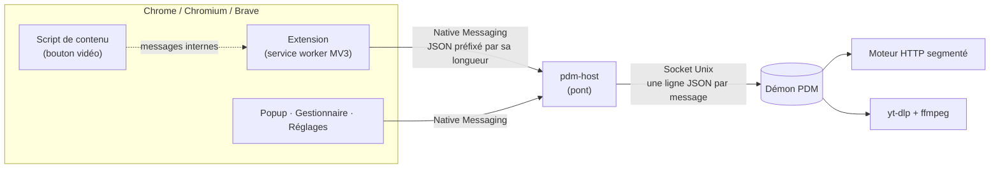

<div align="center">


# PDM — Gestionnaire de téléchargements pour Chrome sous Linux

**Téléchargements multi-connexions, prise de contrôle du navigateur et vidéos en un clic,
dans l'esprit d'Internet Download Manager — pour Chrome, Chromium, Brave, Edge et Vivaldi sous Linux.**

[](https://github.com/dbvrnylh/pdm-download-manager/actions/workflows/ci.yml)
[](LICENSE)


[English](README.md) · [Journal des versions](CHANGELOG.md)

<picture>
  <source media="(prefers-color-scheme: dark)" srcset="docs/screenshots/manager-dark.png">
  
</picture>

</div>

## Points forts

- **Téléchargements accélérés.** Jusqu'à 32 connexions par fichier, avec segmentation dynamique : une connexion
  qui a fini coupe en deux le plus gros segment restant et en prend la moitié. Aucune ne reste inactive.
- **Prise de contrôle sans risque.** Le moteur fait d'abord une requête d'essai ; si le serveur refuse (page de
  connexion, lien à usage unique…), Chrome continue normalement. Aucun téléchargement n'est perdu.
- **Pause, reprise, résistance.** La progression est sauvegardée segment par segment : reprise après une coupure
  réseau, un redémarrage du navigateur ou du PC. Le moteur continue navigateur fermé.
- **Vidéos en un clic.** Un bouton « Télécharger cette vidéo » apparaît sur les lecteurs ; la popup liste les
  médias détectés ; YouTube et des centaines de sites passent par [yt-dlp](https://github.com/yt-dlp/yt-dlp),
  avec choix de la qualité (meilleure, 1080p, 720p, MP3). Les flux HLS/DASH sont assemblés en un seul MP4.
- **Rangement automatique** dans `Videos/`, `Musique/`, `Documents/`, `Archives/`, `Programmes/`, `Images/`,
  `Autres/`. File d'attente, notifications du bureau, clic droit « Télécharger avec PDM ».
- **Rien à installer** pour le moteur : bibliothèque standard de Python uniquement. Thèmes clair et sombre.

## Sommaire

- [Démarrage rapide](#démarrage-rapide)
- [Utilisation](#utilisation)
- [Fonctionnement](#fonctionnement)
- [Réglages](#réglages)
- [Questions fréquentes](#questions-fréquentes)
- [Dépannage](#dépannage)
- [Vie privée et sécurité](#vie-privée-et-sécurité)
- [Développement](#développement)
- [Feuille de route](#feuille-de-route)
- [Désinstallation](#désinstallation)

## Démarrage rapide

**Prérequis :** Linux, un navigateur basé sur Chromium (Chrome 116 ou plus), Python 3.10 ou plus.
Recommandé : `ffmpeg` (fusion audio + vidéo, MP3) et `libnotify-bin` (notifications).

```bash
git clone https://github.com/dbvrnylh/pdm-download-manager.git
cd pdm-download-manager
./install.sh            # sans sudo : tout s'installe dans ton dossier personnel
```

L'installateur copie le moteur dans `~/.local/share/pdm`, le déclare auprès de chaque navigateur Chromium
trouvé, et propose d'installer la copie de yt-dlp de PDM, toujours à jour (réponds **oui**).

Ensuite, charge l'extension :

1. Ouvre `chrome://extensions` (`brave://extensions`, `edge://extensions`…).
2. Active le **Mode développeur**.
3. **Charger l'extension non empaquetée** → choisis le dossier `extension/` de ce dépôt.
4. Ouvre PDM → **Réglages** : tu dois lire **« Moteur PDM 2.0.4 actif »**.

Laisse le dépôt à sa place : le navigateur charge l'extension depuis ce dossier.

## Utilisation

| Je veux… | Comment |
|---|---|
| Télécharger un fichier | Clique le lien comme d'habitude : PDM le reprend et ouvre son gestionnaire. |
| Télécharger une vidéo | Survole le lecteur → **Télécharger cette vidéo** (dans ta qualité par défaut). |
| Choisir la qualité | Survole le lecteur → **▾** à côté du bouton → **Meilleure qualité**, **1080p**, **720p (moyenne)**, **480p (petite)** ou **Audio seul (MP3)**. Ou icône PDM → **Vidéo de cette page**. |
| Un média précis de la page | Icône PDM → **Médias détectés**, ou clic droit sur le lien → **Télécharger avec PDM**. |
| Ajouter une adresse à la main | Gestionnaire → coller l'adresse → **Fichier** ou **Vidéo de la page** → **Ajouter**. |
| Télécharger une liste de liens | Gestionnaire → **Importer une liste…**, ou `pdm-host add --file liens.txt`. Voir [ci-dessous](#télécharger-une-liste-de-liens). |
| Depuis le terminal | `~/.local/share/pdm/app/pdm-host add URL` (`--video` pour passer par yt-dlp, `--quality 720` pour la qualité). |

Si un site très protégé refuse le moteur, **Avec Chrome** relance le téléchargement dans le navigateur,
avec sa propre session.

<table>
  <tr>
    <td width="50%">
      <picture>
        <source media="(prefers-color-scheme: dark)" srcset="docs/screenshots/popup-dark.png">
        
      </picture>
    </td>
    <td width="50%">
      
      <br><br>
      <b>Popup</b> — état du moteur, vidéo de la page en un clic (avec choix de la qualité) et tous les médias
      détectés dans la page.
      <br><br>
      <b>Bouton vidéo</b> — apparaît au survol d'un lecteur, isolé dans un Shadow DOM fermé pour ne jamais
      déformer la page.
    </td>
  </tr>
</table>

### Télécharger une liste de liens

Pour récupérer beaucoup de fichiers d'un coup, prépare un fichier texte avec **un lien par ligne** :

```text
# Cours de réseau (les lignes qui commencent par # sont ignorées)
https://exemple.org/cours/chapitre-1.pdf
https://exemple.org/cours/chapitre-2.pdf

https://exemple.org/cours/annexes.zip
```

Puis, au choix :

- **Gestionnaire** → **Importer une liste…** → **Charger un fichier .txt…** (ou colle les liens dans la zone) →
  **Fichier** ou **Vidéo de la page** → **Ajouter N téléchargements**.
- **Terminal** : `~/.local/share/pdm/app/pdm-host add --file liens.txt` (`--video` pour des pages vidéo,
  `--quality 480` pour leur qualité, `--file -` pour lire l'entrée standard).

Ce qui se passe vraiment :

1. **PDM lit la liste et te montre ce qu'il en a compris**, avant d'ajouter quoi que ce soit : les liens retenus,
   les doublons, ceux déjà dans le gestionnaire, et chaque ligne refusée avec son numéro et la raison
   (`il manque https:// au début`, `un seul lien par ligne`…).
2. **Chaque lien devient un téléchargement en file d'attente**, dans l'ordre de la liste. Le moteur ne fait rien
   de spécial : c'est comme si tu ajoutais les liens un par un à la main.
3. **La file fait le reste.** PDM télécharge autant de fichiers à la fois que le réglage
   **Téléchargements simultanés** (3 par défaut) ; dès qu'un fichier se termine, le suivant démarre.
   Ça continue navigateur fermé, et ça reprend après un redémarrage.
4. **Un lien qui échoue n'arrête pas les autres.** Il passe en *Échec* dans le gestionnaire, avec **Réessayer**.

Bon à savoir :

- Relancer la même liste n'ajoute que les nouveaux liens : ceux déjà dans le gestionnaire **avec le même type** (et,
  pour une vidéo, la même qualité) sont sautés, même en échec (utilise **Réessayer**). Pour retélécharger un fichier terminé, **retire**-le d'abord
  du gestionnaire. Le même lien avec l'autre type, en revanche, est bien ajouté.
- Le type (**Fichier** ou **Vidéo de la page**), comme la qualité des vidéos, vaut pour toute la liste. Pour mélanger fichiers directs et pages
  YouTube, fais deux imports. Une page vidéo importée en **Fichier** passe en *Échec* avec la raison
  « page web reçue au lieu d'un fichier » : rien n'est enregistré, réimporte-la en **Vidéo de la page**.
- Depuis le gestionnaire, PDM transmet les cookies de chaque site (fichiers réservés aux membres…). Depuis le
  terminal, il n'a pas accès au navigateur : pas de cookies.
- 200 liens au maximum par import et 1 Mo pour le fichier : découpe une liste plus longue. Le gestionnaire
  n'affiche que les 300 derniers téléchargements ; au-delà, le début de la liste sortirait de la vue.
- Le moteur doit être installé : sans lui, pas de file d'attente, et Chrome lancerait tout en même temps.

## Fonctionnement



**Pourquoi un démon ?** Chrome tue le programme natif dès que l'extension se déconnecte. Le programme lancé par
Chrome n'est donc qu'un petit pont ; le vrai travail se fait dans un démon indépendant (un seul par utilisateur,
garanti par un fichier verrou). Plusieurs pages peuvent lui parler en même temps, il survit au navigateur, et il
s'arrête seul après dix minutes sans travail.

**Prendre le contrôle d'un téléchargement.** Chrome demande aux extensions où enregistrer chaque nouveau fichier
(`downloads.onDeterminingFilename`) et ne peut pas terminer le téléchargement sans réponse. PDM profite de ce
délai pour confier l'adresse au moteur, avec les cookies et le Referer de la page. Le moteur fait une requête
d'essai : s'il obtient le fichier, le téléchargement de Chrome est annulé et le moteur prend le relais ; s'il
obtient une erreur ou une page HTML, Chrome continue.

**Téléchargement segmenté.**

1. La requête d'essai demande `Range: bytes=0-`. Une réponse `206 Partial Content` prouve que le serveur accepte
   les plages d'octets, et `Content-Range` donne la taille totale.
2. Le fichier est préalloué puis découpé en segments. Chaque connexion demande sa plage et écrit à sa position
   avec `os.pwrite` ; la connexion de la requête d'essai sert de première connexion.
3. Quand le serveur fournit un `ETag` ou un `Last-Modified`, chaque requête porte `If-Range` : un fichier modifié
   sur le serveur est détecté au lieu d'être corrompu en silence. Un serveur incohérent d'une requête à l'autre
   passe automatiquement en une seule connexion.
4. L'état des segments est sauvegardé toutes les deux secondes : après une pause, un plantage ou un redémarrage,
   chaque segment repart là où il s'était arrêté.

**Vidéos.** yt-dlp sait lire les listes de lecture de streaming, choisir une qualité et fusionner l'audio avec la
vidéo. PDM le pilote comme un sous-processus et lit sa progression ligne par ligne. PDM garde sa propre copie de
l'exécutable officiel de yt-dlp — qui embarque le solveur JavaScript qu'exige désormais YouTube — et la met à
jour chaque jour. Une vidéo en streaming arrive en dizaines de morceaux et en pistes séparées avant d'être assemblée : yt-dlp la
prépare dans un dossier caché `.pdm-en-cours/` du dossier de téléchargement (même disque : le déplacement final
est instantané), et seul le fichier terminé apparaît à côté de tes vidéos. Le dossier est effacé à la fin du
téléchargement ou à son annulation ; un téléchargement en pause reprend à partir de lui.

**Flux découpés en pistes.** Beaucoup de sites (Arte…) servent un *manifeste maître* HLS : un menu qui liste des
variantes vidéo sans son (432p, 1080p…) et des pistes audio séparées (une par langue). Le lecteur charge ensuite la
playlist de chaque piste qu'il joue. Donner l'une de ces pistes à yt-dlp donnerait une vidéo sans son, ou du son
sans image. L'extension ne voit pas le contenu des réponses : elle relit donc chaque nouvelle `.m3u8` une fois. Un
maître garde la liste de ses pistes, et ces pistes ne sont ni proposées dans la popup ni utilisées par le bouton
vidéo.

**Sous-titres.** Quand une page vidéo propose des sous-titres dans tes langues (français, espagnol et anglais par
défaut), ils sont intégrés au fichier vidéo, en pistes à choisir dans ton lecteur (VLC, mpv…) ; aucun `.vtt` ne
reste à côté. Seuls les sous-titres écrits par des humains sont pris : YouTube propose aussi des traductions
automatiques dans une centaine de langues, de qualité inégale, et les demander fait bloquer par le site. Les
sous-titres sont un bonus : si leur téléchargement échoue, PDM refait la vidéo sans eux plutôt que de la perdre.

**Pistes audio.** Beaucoup de vidéos ont plusieurs pistes audio : Arte propose la version originale, le français,
l'allemand et l'audiodescription ; YouTube, des doublages dans une vingtaine de langues. Par défaut, yt-dlp n'en
garde qu'une, et chez Arte, où toutes ont la même priorité, laquelle relève du hasard. PDM analyse d'abord la page
(`yt-dlp -J`), garde la **version originale** (marquée « VO » par Arte, « original » par YouTube) puis une piste par
langue à toi qui existe (la meilleure qualité de chacune), et réutilise cette analyse pour le téléchargement
(`--load-info-json`) : le site n'est interrogé qu'une fois. L'audiodescription et les doublages automatiques de
YouTube sont écartés. Chaque piste est étiquetée avec sa langue, l'originale en premier : c'est celle que le lecteur
joue par défaut. Si l'une des pistes choisies ne se télécharge pas, PDM refait la vidéo avec une seule piste.

## Réglages

Tout se règle dans la page **Réglages** de l'extension :

| Réglage | Par défaut | Remarques |
|---|---|---|
| Dossier de destination | ton dossier Téléchargements (XDG) | Détecté avec `xdg-user-dir`. **Choisir…** ouvre le sélecteur de dossier de ton bureau (zenity ou kdialog), ou tape un chemin (`~/Documents` marche). Les dossiers de catégorie sont créés dedans. Avant d'enregistrer, PDM crée le dernier niveau s'il manque et écrit un fichier d'essai : un dossier où tu ne peux pas écrire est refusé avec la raison, et l'ancien est gardé. |
| Qualité des vidéos | meilleure | Meilleure, 1080p, 720p, 480p ou audio seul : la hauteur d'image maximale, ou la meilleure en dessous. Sert dès qu'aucune qualité n'est choisie (bouton, gestionnaire, listes, terminal). Le nom du fichier porte la résolution obtenue (`Titre [720p].mp4`) : chaque qualité a son propre fichier. |
| Connexions par fichier | 8 | De 1 à 32. Monter n'aide que si le serveur limite chaque connexion. |
| Téléchargements simultanés | 3 | De 1 à 10 ; les suivants attendent dans la file. |
| Rangement par catégorie | activé | `Videos/`, `Musique/`, `Archives/`… (noms en ASCII exprès). |
| Notifications du bureau | activé | Nécessite `notify-send`. |
| Reprise automatique | activé | Relance les téléchargements interrompus au démarrage du moteur. |
| Tes langues | `fr, es, en` | Pour les sous-titres et les pistes audio en plus, dans cet ordre. |
| Sous-titres | activé | Intégrés aux vidéos quand ils existent. Nécessite ffmpeg. |
| Pistes audio | activé | Garde la version originale plus tes langues quand elles existent. Nécessite ffmpeg. |
| Prise de contrôle · Ouverture du gestionnaire · Bouton vidéo | activés | Réglages côté navigateur. |

Les réglages du moteur sont enregistrés dans `~/.local/share/pdm/config.json`.

## Questions fréquentes

**Comment se compare-t-il à IDM ?**
Même principe — téléchargements segmentés et reprenables pilotés depuis le navigateur — et mêmes limites : aucun
programme externe ne peut réutiliser la connexion que le navigateur a déjà ouverte. Les liens à usage unique et
les protections anti-robots fondées sur l'empreinte TLS du navigateur ne peuvent donc pas être repris. Quand la
requête d'essai du moteur est refusée, PDM laisse automatiquement le téléchargement à Chrome ; si un serveur
refuse le moteur plus tard, **Avec Chrome** le relance dans le navigateur. L'équivalent chez IDM est sa liste de
sites exclus.

**Pourquoi les vidéos YouTube n'utilisent-elles qu'une connexion ?**
Parce que c'est le plus rapide : YouTube sert déjà une seule connexion à pleine vitesse. Mesuré sur une connexion
domestique : **23,4 Mio/s** avec une connexion, contre **17,3 Mio/s** avec 8 fragments HLS en parallèle. Les
connexions multiples ne paient que face à un serveur qui limite chaque connexion — c'est là que la segmentation de
PDM fait la différence.

**Peut-il télécharger depuis Netflix, Spotify, Disney+… ?**
Non. Ces contenus sont protégés par DRM, et contourner une mesure technique de protection est illégal dans de
nombreux pays (dans l'UE, directive 2001/29/CE, transposée en France par la loi DADVSI). PDM n'essaie pas.

**Les téléchargements continuent-ils navigateur fermé ?**
Oui. Le démon est indépendant du navigateur ; rouvre le gestionnaire pour voir le résultat.

**Et Firefox ?** Pas encore — voir la [feuille de route](#feuille-de-route).

## Dépannage

| Symptôme | Solution |
|---|---|
| « moteur PDM non installé » | Relance `./install.sh`, puis recharge la page de réglages. |
| « dossier de téléchargement introuvable » | Le dossier choisi dans **Réglages** a disparu (disque externe débranché ?). PDM ne le recrée jamais, ce qui mettrait tes téléchargements sur le disque interne sans que tu le saches : rebranche le disque ou choisis un autre dossier. |
| Les réglages affichent une ancienne version du moteur | Tu as lancé un ancien `install.sh` : lance celui de ce dépôt. |
| Une vidéo YouTube échoue (403…) | Vérifie dans **Réglages** que yt-dlp est la « copie PDM » ; sinon relance `./install.sh` et accepte. Installe [deno](https://deno.com) (ou node) pour tous les formats YouTube. |
| Le bouton vidéo n'apparaît pas | Les lecteurs de moins de 240 × 135 px sont ignorés (miniatures, publicités). |
| Chromium en snap ou Flatpak | Leur bac à sable peut bloquer le moteur : préfère un paquet `.deb` ou natif. |

État du moteur : `~/.local/share/pdm/app/pdm-host status` · Journal : `~/.local/share/pdm/engine.log`
(contient la sortie complète de yt-dlp pour les vidéos en échec).

## Vie privée et sécurité

- **Ni télémétrie, ni serveur.** Tout tourne en local ; rien n'est envoyé ailleurs que vers les sites téléchargés.
- **Seule cette extension peut lancer le moteur :** la déclaration du programme natif n'autorise qu'un identifiant
  d'extension, fixé par la clé publique de `manifest.json`.
- **Les cookies restent à leur place.** Ils ne sont transmis au moteur que pour le site du téléchargement, et
  retirés si une redirection quitte ce site. La liste des téléchargements qui les contient (`jobs.json`) n'est
  lisible que par ton utilisateur (`0600`), tout comme le socket Unix du démon.
- **Tout ce qui vient du web est considéré comme hostile :** noms de fichiers nettoyés, aucun contenu injecté avec
  `innerHTML`, yt-dlp appelé avec une liste d'arguments (sans shell) après `--`.
- Les téléchargements en **navigation privée** ne sont jamais repris par le moteur.

## Développement

```
extension/                 extension Chrome (Manifest V3, modules ES, sans compilation)
  background.js            service worker : détection des médias, prise de contrôle, menus
  content/grab.js          bouton vidéo (Shadow DOM fermé)
  lib/                     client du moteur, détection des médias, noms de fichiers, réglages…
  popup/ manager/ options/ interface
engine/
  pdm-host                 point d'entrée (pont, démon, ligne de commande)
  pdm_engine/              httpdl.py (HTTP segmenté) · ytdlp.py · engine.py (file d'attente, persistance)
                           daemon.py (socket Unix) · host.py (pont Native Messaging)
tests/                     tests d'intégration Python contre un serveur HTTP local, tests unitaires Node
install.sh · uninstall.sh
```

Lancer les tests :

```bash
python3 -m unittest discover -s tests -v   # moteur, démon, pont, yt-dlp (≈ 1 min)
node --test tests/lib.test.mjs             # modules de l'extension
npx eslint extension                       # analyse du code
```

La suite Python démarre un vrai serveur HTTP qui simule les plages d'octets, un débit limité par connexion, des
coupures, des fichiers modifiés en cours de route, des ETag instables et des redirections vers un autre hôte, puis
vérifie le SHA-256 de chaque fichier téléchargé. Les tests yt-dlp génèrent leur propre flux HLS avec ffmpeg ; ils
sont ignorés si yt-dlp ou ffmpeg manquent. La CI lance tout à chaque envoi.

Choix de conception :

- **Bibliothèque standard uniquement** pour le moteur : rien à installer avec `pip`, fonctionne avec le Python du
  système.
- **Aucune compilation** pour l'extension : de simples modules ES, chargeables tels quels.
- **Un seul écrivain par ressource :** les lectures-modifications-écritures asynchrones sur `chrome.storage` sont
  sérialisées ; l'état du moteur est protégé par des verrous pris toujours dans le même ordre
  (`save_lock → lock → verrou du téléchargement`).

## Feuille de route

- Rejouer tous les en-têtes envoyés par le navigateur (pas seulement cookies et Referer), comme IDM.
- S'adapter aux serveurs qui limitent le nombre de connexions au lieu d'échouer.
- Retour automatique vers Chrome, avec une liste de sites exclus.
- Interface en anglais.
- Prise en charge de Firefox et paquets (`.deb`, AUR).

## Désinstallation

```bash
./uninstall.sh          # garde l'historique et les réglages
./uninstall.sh --purge  # supprime aussi l'historique, les réglages et la copie de yt-dlp
```

Puis retire l'extension dans `chrome://extensions`. Tes fichiers téléchargés ne sont jamais touchés.

## Mentions légales

PDM est un outil de téléchargement généraliste. Ne télécharge que ce que tu as le droit de télécharger, et
respecte les conditions d'utilisation des sites. PDM ne contourne pas les DRM.

## Licence

[MIT](LICENSE) © 2026 Pablo Raudiel Ramos Cabrera

Construit grâce à [yt-dlp](https://github.com/yt-dlp/yt-dlp) et [FFmpeg](https://ffmpeg.org/).
