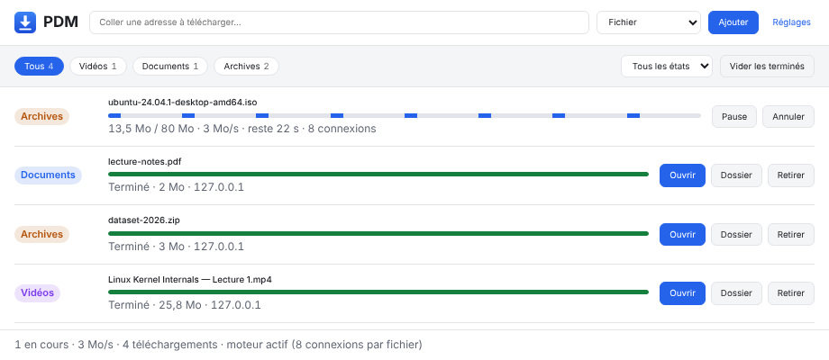
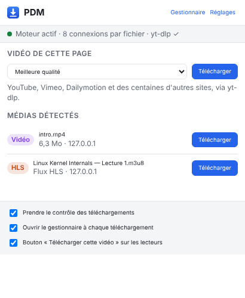
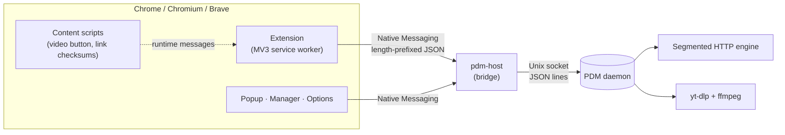

<div align="center">


# PDM — Download Manager for Chrome on Linux

**Multi-connection downloads, browser takeover and one-click video grabbing,
in the spirit of Internet Download Manager — for Chrome, Chromium, Brave, Edge and Vivaldi on Linux.**

[](https://github.com/dbvrnylh/pdm-download-manager/actions/workflows/ci.yml)
[](LICENSE)


[Français](README.fr.md) · [Changelog](CHANGELOG.md)

<picture>
  <source media="(prefers-color-scheme: dark)" srcset="docs/screenshots/manager-dark.png">
  
</picture>

</div>

## Highlights

- **Faster downloads.** Up to 32 connections per file with dynamic segmentation: when a connection finishes,
  it splits the segment that would finish last and takes half of it, and a lagging connection is reopened, so
  no connection sits idle and none holds up the others.
- **Takes over the browser's downloads** — safely. The engine probes the file first; if the server refuses it
  (login page, one-time link…), Chrome simply carries on. A download is never lost.
- **Pause, resume, survive.** Progress is persisted per segment: downloads resume after a network drop,
  a browser restart or a reboot. The engine keeps downloading when the browser is closed.
- **Verified files.** Every file's SHA-256 is computed while it downloads and compared with the checksum shown next
  to the link (GitHub, Linux distributions…) or announced by the server: a damaged file is never delivered.
  **Vérifier…** checks a finished file against a checksum you paste.
- **Several servers at once.** When the site lists its mirrors (Metalink/HTTP, like LibreOffice or Kiwix), also
  for a download taken from the browser, each connection goes to the fastest server of the moment: when the origin
  limits or slows down, the mirrors take over, and a mirror that is down, slow or serves another file is dropped.
  Only when a checksum can verify the whole file.
  With the checksum of each piece (`.meta4`), a wrong piece is downloaded again alone.
- **Videos in one click.** A "download this video" button appears on players; the popup lists detected media;
  YouTube and hundreds of sites are supported through [yt-dlp](https://github.com/yt-dlp/yt-dlp), with quality
  presets (best, 1080p, 720p, 480p, MP3). HLS/DASH streams are merged into a single MP4.
- **Organized.** Files are sorted into `Videos/`, `Musique/`, `Documents/`, `Archives/`, `Programmes/`,
  `Images/` and `Generique/` for the rest, by extension; each category's extensions and folder name can be edited. Download queue, desktop notifications, right-click "Télécharger avec PDM".
- **Speaks aria2.** AriaNg, aria2 scripts and the extensions that send their links to aria2 can drive PDM through
  the same JSON-RPC API: local only, with a secret, and off until you turn it on.
- **No dependencies to install** for the engine: Python standard library only. Light and dark themes.

> The user interface is currently in French.

## Contents

- [Quick start](#quick-start)
- [Usage](#usage)
- [How it works](#how-it-works)
- [Configuration](#configuration)
- [FAQ](#faq)
- [Troubleshooting](#troubleshooting)
- [Privacy & security](#privacy--security)
- [Development](#development)
- [Roadmap](#roadmap)
- [Uninstall](#uninstall)

## Quick start

**Requirements:** Linux, a Chromium-based browser (Chrome 116+), Python 3.10+.
Recommended: `ffmpeg` (merging video + audio, MP3) and `libnotify-bin` (notifications).

```bash
git clone https://github.com/dbvrnylh/pdm-download-manager.git
cd pdm-download-manager
./install.sh            # no sudo: everything goes into your home directory
```

The installer copies the engine to `~/.local/share/pdm`, registers it with every Chromium-based browser it finds,
and offers to install PDM's own, always up-to-date copy of yt-dlp (answer **yes**).

Then load the extension:

1. Open `chrome://extensions` (`brave://extensions`, `edge://extensions`…).
2. Turn on **Developer mode**.
3. Click **Load unpacked** and select the `extension/` folder of this repository.
4. Open PDM → **Réglages**: you should read **"Moteur PDM 2.0.4 actif"**.

Keep the repository where it is: the browser loads the extension from it.

## Usage

| I want to… | How |
|---|---|
| Download a file | Click the link as usual — PDM takes over and opens its manager. |
| Download a video | Hover the player → **Télécharger cette vidéo** (in your default quality). |
| Pick the quality | Hover the player → **▾** next to the button → **Meilleure qualité**, **1080p**, **720p (moyenne)**, **480p (petite)** or **Audio seul (MP3)**. Or PDM icon → **Vidéo de cette page**. |
| Grab a specific media file | PDM icon → **Médias détectés**, or right-click a link → **Télécharger avec PDM**. |
| Add a URL by hand | Manager → paste the address → **Fichier** or **Vidéo de la page** → **Ajouter**. |
| Download a list of links | Manager → **Importer une liste…**, or `pdm-host add --file links.txt`. See [below](#downloading-a-list-of-links). |
| Download later (at night) | Manager → **Plus tard** on a download, or the **Plus tard** box when importing a list, or `pdm-host add --later URL`. It only progresses during the time window of **Réglages**; the rest starts right away. |
| Verify a file | Nothing to do when the page shows its checksum next to the link: PDM picks it up on click and checks the file. Otherwise, Manager → **Vérifier…** on a finished download → paste the site's checksum (SHA-256, SHA-512, SHA-1 or MD5). Not the one PDM shows: compared with itself, a file always matches, and PDM refuses it. |
| Use the terminal | `~/.local/share/pdm/app/pdm-host add URL` (`--video` to go through yt-dlp, `--quality 720` to pick the quality, `--checksum sha-256=…` for an expected checksum, as in aria2). |
| Drive PDM from other tools | Settings → *Piloter PDM depuis d'autres outils*, or `pdm-host rpc on`: the aria2-compatible JSON-RPC API, for AriaNg and aria2 scripts. See [below](#the-aria2-compatible-api). |

If a heavily protected site refuses the engine, **Avec Chrome** retries the download in the browser,
with the browser's own session.

<table>
  <tr>
    <td width="50%">
      <picture>
        <source media="(prefers-color-scheme: dark)" srcset="docs/screenshots/popup-dark.png">
        
      </picture>
    </td>
    <td width="50%">
      
      <br><br>
      <b>Popup</b> — engine status, one-click download of the page's video (with quality presets) and every media file
      detected on the page.
      <br><br>
      <b>Video button</b> — appears when hovering a player, isolated in a closed Shadow DOM so it never breaks the
      site's layout.
    </td>
  </tr>
</table>

### Downloading a list of links

To grab many files at once, prepare a text file with **one link per line**:

```text
# Networking course (lines starting with # are ignored)
https://example.org/course/chapter-1.pdf
https://example.org/course/chapter-2.pdf

https://example.org/course/appendix.zip
```

Then either:

- **Manager** → **Importer une liste…** → **Charger un fichier .txt…** (or paste the links into the box) →
  **Fichier** or **Vidéo de la page** → **Ajouter N téléchargements**.
- **Terminal**: `~/.local/share/pdm/app/pdm-host add --file links.txt` (`--video` for video pages,
  `--quality 480` for their quality, `--file -` to read standard input).

What actually happens:

1. **PDM reads the list and shows you how it understood it** before adding anything: the links it kept,
   duplicates, links already in the manager, and every rejected line with its number and the reason
   (`il manque https:// au début`, `un seul lien par ligne`…).
2. **Each link becomes a queued download**, in the order of the list. Nothing special happens in the engine:
   it is the same as adding the links one by one by hand.
3. **The queue does the rest.** PDM downloads as many files at once as the **Téléchargements simultanés**
   setting (3 by default); as soon as one finishes, the next one starts. It keeps going with the browser
   closed, and resumes after a reboot.
4. **A failing link doesn't stop the others.** It shows up as failed in the manager, with **Réessayer**.

Good to know:

- Importing the same list again only adds the new links: those already in the manager **with the same type** (and, for
  videos, the same quality) are skipped, even failed ones (use **Réessayer**). To download a finished file again, **remove** it from the manager
  first. The same link with the other type, however, is added.
- The type (**Fichier** or **Vidéo de la page**), like the video quality, applies to the whole list. To mix direct files and YouTube
  pages, import twice. A video page imported as **Fichier** fails with "page web reçue au lieu d'un fichier"
  (a web page instead of a file): nothing is saved, import it again as **Vidéo de la page**.
- From the manager, PDM forwards each site's cookies (members-only files…). From the terminal it has no access
  to the browser: no cookies.
- At most 200 links per import and 1 MB for the file: split a longer list. The manager only shows the last 300
  downloads; beyond that, the start of the list would scroll out of view.
- The engine must be installed: without it there is no queue, and Chrome would start everything at once.

### The aria2-compatible API

Tools written for [aria2](https://aria2.github.io/) can drive PDM: [AriaNg](https://github.com/mayswind/AriaNg),
scripts, extensions that send it their links. PDM speaks the core of aria2's JSON-RPC API, over HTTP and
WebSocket. It is off until you ask, in the extension's settings (*Piloter PDM depuis d'autres outils*: the switch,
the port, the secret to copy, the web pages allowed) or in a terminal:

```bash
~/.local/share/pdm/app/pdm-host rpc on
```

It prints the address (`http://127.0.0.1:6800/jsonrpc`, aria2's own port, so tools find it as is) and the secret,
to give the tool as aria2's `--rpc-secret`. In AriaNg: host `127.0.0.1`, port `6800`, protocol WebSocket, path
`/jsonrpc`, and the secret. From a script, for example:

```bash
curl -s http://127.0.0.1:6800/jsonrpc -d '{"jsonrpc":"2.0","id":1,"method":"aria2.addUri",
  "params":["token:SECRET",["https://example.org/file.iso"],{"checksum":"sha-256=…"}]}'
```

- `pdm-host rpc` shows the address and the secret, `pdm-host rpc off` turns it off, `pdm-host rpc new-secret`
  replaces the secret (the old one stops working at once), `pdm-host rpc on --port 6801` moves it when aria2
  already uses 6800.
- A web page can only call it if you allow its origin: `pdm-host rpc on --allow https://ariang.example`
  (several `--allow` for several, `--allow none` for none again).
- While it is on, the engine stays running even with nothing to do, like aria2: the tools expect to find it.
- Over WebSocket (`ws://127.0.0.1:6800/jsonrpc`), the same calls, plus aria2's notifications: `onDownloadStart`,
  `onDownloadPause`, `onDownloadStop`, `onDownloadComplete` and `onDownloadError`, sent the moment a download
  changes state, so a tool no longer asks for the state of every download each second.
- What works: adding (`addUri`, with `out`, `header`, `referer`, `user-agent`, `checksum`, `pause`; several
  addresses are mirrors of the same file, used when a checksum can verify it), following (`tellStatus`,
  `tellActive`, `tellWaiting`, `tellStopped`, `getGlobalStat`, `getFiles`, `getUris`), pausing, resuming and
  removing, one by one or all at once, the global settings (`changeGlobalOption`: simultaneous downloads,
  connections, speed limit, folder), `system.multicall` and batches.
- Not yet: the queue order (`changePosition`) and per-download options (`changeOption`). Files always go to PDM's folder, sorted by category: `dir` is only
  accepted when it names that folder. Options about how to download (`split`, `max-connection-per-server`…) are
  accepted and left to PDM.

## How it works



**Why a daemon?** Chrome kills a native messaging host as soon as the extension disconnects. The host is
therefore a tiny bridge, and the real work happens in an independent daemon (one per user, guarded by a
lock file). Several pages can talk to it at once, it survives the browser, and it exits on its own after
ten minutes without work.

**Taking over a download.** Chrome asks extensions where to save each new file (`downloads.onDeterminingFilename`)
and cannot finish the download until it gets an answer. PDM uses that window to hand the URL to the engine,
along with the page's cookies and referrer. The engine sends a probe request: if it gets the actual file,
Chrome's download is cancelled and the engine takes over; if it gets an error or an HTML page, Chrome keeps going.

**Segmented downloading.**

1. The probe asks for `Range: bytes=0-`. A `206 Partial Content` answer proves the server supports ranges,
   and `Content-Range` gives the total size.
2. The file's space is reserved on the disk (`fallocate`), then it is split into segments. Each connection requests its range and writes at its
   offset with `os.pwrite`; the probe's connection is reused as the first one.
3. When the server provides an `ETag` or `Last-Modified`, every range request carries `If-Range`, so a file that
   changes on the server is detected instead of silently corrupted. Servers that answer inconsistently get a
   single-connection fallback.
4. Segment state is saved every two seconds, but only promises what the disk has confirmed (`fdatasync` every
   five seconds and at each pause): after a pause, a crash, a reboot or a power cut, each segment resumes from its
   last safe point, a few seconds back at worst. A file is only "Terminé" once the disk has confirmed it and its
   name.
5. Many servers only accept a few connections per IP address and refuse the next ones (503, 429…). At the first
   refusal, PDM notes what that site accepts — the most connections it accepted at once — and sticks to it for all
   its downloads: one more connection waits for a slot ("En attente du serveur…") instead of failing, and a file
   starts with only as many segments as the site accepts. The limit goes up by one connection every 15 seconds
   without a refusal, and is forgotten after ten minutes.
6. A connection can land on a slow route or an overloaded server and keep the end of the file to itself. PDM
   measures each connection: one going eight times slower than the download's best, or receiving nothing for five
   seconds, is closed and reopened (it often lands elsewhere), without waiting for the 30-second network timeout.
   Near the end, a free connection takes half of what is left to the one that would finish last, even a small
   remainder when that one lags.
7. The file's SHA-256 is computed while it downloads, by reading back in order what was just written (still in
   memory), then compared with the expected checksums. They come from the page (on a click on a link, the
   extension picks up the checksum shown on its row — next to each file on GitHub — or in a `SHA256SUMS` list that
   names it; when in doubt, none), from the server (`Repr-Digest`, `Digest`, Google Cloud Storage's `x-goog-hash`,
   the redirect of Hugging Face or of a mirror server such as LibreOffice's) or from the user. A file that does not
   match is never delivered: it stays as `.pdm`, the download fails with both checksums, and **Réessayer** starts
   over from zero.
8. A mirror server (Metalink/HTTP, RFC 6249) lists the file's other mirrors on its redirect
   (`Link: <…>; rel=duplicate`) along with its checksum. A download taken from the browser arrives with the
   address Chrome was redirected to: the extension also sends the address it started from, and the engine asks it
   again, one redirect at a time, stopping at the first that announces something. When an expected checksum will
   verify the whole file, PDM takes pieces from several of them: at the end of each segment, the connection moves
   to the fastest server measured, and once a second, a connection on a server much slower than another that has
   room leaves its segment to the next connection and moves there. An unknown mirror is tried one at a time, and
   only when the download should last more than ten seconds or connections are waiting for a place: on a line the
   nearest mirror already fills, the others get nothing. A mirror that does not serve a file of the same size,
   fails or lags is dropped; if the final file does not match, the next try does without mirrors.
9. The same server often announces a Metalink document (`.meta4`) with the checksum of each piece of the file
   (256 KB at LibreOffice). PDM then checks every piece while it computes the SHA-256, in the same read: a wrong
   piece is downloaded again alone, without the mirrors that had sent any byte of it, and the checksums start
   again from the first wrong piece. Up to three rounds, instead of starting over. The document is read again at
   each start, only over `https://` for an `https://` download, and refused if it declares XML entities (which
   can multiply until memory runs out).

**Videos.** yt-dlp knows how to read streaming playlists, choose a quality and merge audio with video.
PDM drives it as a subprocess and parses its progress line by line. PDM keeps its own copy of the official
yt-dlp build — which bundles the JavaScript challenge solver YouTube now requires — and updates it daily.
A streamed video arrives in dozens of fragments and separate tracks before being merged: yt-dlp prepares it in
a hidden `.pdm-en-cours/` folder inside the download folder (same disk, so the final move is instant), and only
the finished file appears next to your videos. The folder is removed once the download ends or is canceled;
a paused download resumes from it.

**Streams split into tracks.** Many sites (Arte…) serve an HLS *master playlist*: a menu listing video
variants without sound (432p, 1080p…) and separate audio tracks (one per language). The player then loads the
playlist of each track it plays. Handing one of those tracks to yt-dlp would give a video without sound, or sound
without a picture. The extension cannot see response bodies, so it reads each new `.m3u8` once: a master keeps the
list of its tracks, and those tracks are neither listed in the popup nor used by the video button.

**Subtitles.** When a video page offers subtitles in your languages (French, Spanish and English by default),
they are embedded into the video file as tracks you pick in your player (VLC, mpv…); no `.vtt` file is left
next to it. Only human-made subtitles are taken: YouTube also offers machine translations into about a hundred
languages, of uneven quality, and requesting them gets you rate-limited. Subtitles are a bonus: if they fail to
download, PDM downloads the video again without them rather than losing it.

**Audio tracks.** Many videos come with several audio tracks: Arte offers the original version, French,
German and audio description; YouTube offers dubs in up to twenty languages. By default yt-dlp keeps only one,
and on Arte, where every track has the same priority, which one is down to luck. PDM first analyzes the page
(`yt-dlp -J`), keeps the **original version** (marked "VO" by Arte, "original" by YouTube) followed by one track
per language of yours that exists (the best quality of each), then reuses that analysis for the download
(`--load-info-json`) so the site is only queried once. Audio description and YouTube's automatic dubs are left out.
Each track is labeled with its language, and the original comes first, so it is the player's default. If one of
the chosen tracks can't be downloaded, PDM downloads the video again with a single track.

## Configuration

Everything lives in the extension's **Réglages** page:

| Setting | Default | Notes |
|---|---|---|
| Download folder | your XDG Downloads folder | Detected with `xdg-user-dir`. **Choisir…** opens your desktop's folder picker (zenity or kdialog), or type a path (`~/Documents` works). Category folders are created inside it. Before saving, PDM creates the last folder level if needed and writes a test file: a folder you can't write to is refused with the reason, and the previous one is kept. |
| Video quality | best | Best, 1080p, 720p, 480p or audio only: the highest picture height, or the best below it. Used whenever no quality is picked (button, manager, lists, terminal). File names carry the resolution obtained (`Title [720p].mp4`), so each quality gets its own file. |
| Connections per file | 8 | 1–32. More only helps when a server throttles each connection. A site that accepts fewer is followed automatically (see [How it works](#how-it-works)). |
| Speed limit | none | For PDM as a whole, all downloads together, so a big download doesn't saturate the home connection. Files share one token bucket; each yt-dlp video gets a fixed share of it when it starts (an approximation: a new limit applies to videos from their next start). |
| Time window | 23:00 → 06:00 | When downloads marked **Plus tard** progress; it may cross midnight. When it closes, an unfinished one goes back to the queue and resumes from what it received at the next window. The computer must stay on (the engine stays up by itself while downloads are waiting). |
| Simultaneous downloads | 3 | 1–10; the rest waits in the queue. |
| Sort by category | on | `Videos/`, `Musique/`, `Archives/`… (ASCII folder names on purpose). |
| Categories | IDM-like lists | Each category's **extensions** and **folder name** are edited in **Réglages → Catégories**; whatever matches none goes to **Générique** (`Generique/`). A file is sorted by its extension, else by the type the server announces. An extension can only belong to one category, and folder names stay in ASCII (Chrome silently refuses an accented path when the system locale isn't UTF-8). Already downloaded files don't move. |
| Desktop notifications | on | Needs `notify-send`. |
| Auto-resume | on | Restarts interrupted downloads when the engine starts. |
| Your languages | `fr, es, en` | Used for subtitles and extra audio tracks, in this order. |
| Subtitles | on | Embedded into video downloads when they exist. Needs ffmpeg. |
| Audio tracks | on | Keeps the original audio plus your languages when they exist. Needs ffmpeg. |
| Take over browser downloads · Open manager · Video button | on | Browser-side settings. |

Engine settings are stored in `~/.local/share/pdm/config.json`.

## FAQ

**How does it compare to IDM?**
Same core idea — segmented, resumable downloads driven from the browser. Like IDM, PDM replays the request the
browser sent for a download it takes over (its cookies, `Accept-Language`, `sec-fetch-*`…), which some anti-bot
checks require; `Range`, compression and conditional headers are left out, and cookies and `Authorization` never
follow a redirect to another site. Same limits too: no external
program can reuse the connection the browser already opened, so one-time links and anti-bot checks based on the
browser's TLS fingerprint can't be taken over. When the engine's probe is refused, PDM leaves the download to
Chrome automatically; if a server refuses the engine later on, **Avec Chrome** retries it in the browser.
IDM's equivalent is its per-site exception list.

**Why do YouTube videos use a single connection?**
Because it is the fastest option: YouTube already serves one connection at full speed. Measured on a home
connection: **23.4 MiB/s** with one connection versus **17.3 MiB/s** with 8 parallel HLS fragments.
Multiple connections only pay off when a server throttles each connection — that's where PDM's segmentation
shines.

**Can it download from Netflix, Spotify, Disney+…?**
No. That content is protected by DRM, and circumventing technical protection measures is illegal in many
countries (in the EU under Directive 2001/29/EC, implemented in France by the DADVSI law). PDM does not try.

**Does it keep downloading when I close the browser?**
Yes. The daemon is independent from the browser; reopen the manager to see the results.

**Firefox?** Not yet — see the [roadmap](#roadmap).

## Troubleshooting

| Symptom | Fix |
|---|---|
| "moteur PDM non installé" | Run `./install.sh` again, then reload the options page. |
| "dossier de téléchargement introuvable" | The folder chosen in **Réglages** is gone (external disk unplugged?). PDM never recreates it, which would put your downloads on the internal disk unnoticed: plug the disk back in or choose another folder. |
| The options page shows an old engine version | You ran an old `install.sh`; run the one from this repository. |
| A YouTube video fails (403…) | Check that yt-dlp is the "copie PDM" in **Réglages**; if not, run `./install.sh` and accept it. Install [deno](https://deno.com) (or node) for full YouTube support. |
| The video button doesn't appear | Players smaller than 240×135 px are ignored (thumbnails, ads). |
| Chromium as a snap or Flatpak | Their sandbox may block native messaging; prefer a `.deb`/native package. |

Engine status: `~/.local/share/pdm/app/pdm-host status` · Log: `~/.local/share/pdm/engine.log`
(includes the full yt-dlp output of failed video downloads).

## Privacy & security

- **No telemetry, no server.** Everything runs locally; nothing is sent anywhere except the downloads themselves.
- **Only this extension can start the engine:** the native host manifest allows a single extension ID,
  pinned by the public key in `manifest.json`.
- **Cookies stay scoped.** They are forwarded to the engine only for the download's site and are stripped when a
  redirect leaves that host; mirrors never get them, and an `http://` mirror listed by an `https://` site is
  ignored. The job list that stores them (`jobs.json`) is readable by your user only (`0600`),
  and the daemon's Unix socket is private to your user.
- **Hostile input is treated as such:** file names are sanitized, page content is never injected with `innerHTML`,
  and yt-dlp is called with an argument list (no shell) after `--`.
- **The JSON-RPC API is off until you turn it on.** Then it listens on `127.0.0.1` only, never the network. Every
  call needs its 256-bit secret, kept in a file readable by your user only (`rpc.json`, `0600`). Unlike the
  daemon's socket, a local port can be reached by every account and program on the machine. The `Host` header
  must name `127.0.0.1` or `localhost`, against DNS rebinding (a page pointing its own domain at your machine).
  Web pages are refused unless you allow their origin, and for WebSocket that check is the only barrier: browsers
  apply no CORS to it, so without it any site could connect. POST only: aria2's JSONP over GET, which any site can
  read, is not offered. Like aria2's, the notifications go to every connected client, secret or not: they carry
  only a download's GID, which allows nothing without the secret. A WebSocket client that stops reading or
  answering pings is cut, never waited for.
- **Private browsing** downloads are never taken over.
- **Link checksums stay in the extension:** on a click on a file's link, only the text of its row and the page
  lines that name it are read, kept in memory for a minute, and never sent anywhere but to the engine.

## Development

```
extension/                 Chrome extension (Manifest V3, ES modules, no build step)
  background.js            service worker: media detection, takeover, context menus
  content/grab.js          video button (closed Shadow DOM)
  content/links.js         checksums shown next to links, picked up on click
  lib/                     engine client, media detection, file names, settings…
  popup/ manager/ options/ user interface
engine/
  pdm-host                 entry point (bridge, daemon, CLI)
  pdm_engine/              httpdl.py (segmented HTTP) · ytdlp.py · engine.py (queue, persistence)
                           hosts.py (connections per site) · limiter.py (speed limit)
                           checksum.py (expected and computed checksums) · metalink.py (mirrors)
                           daemon.py (Unix socket) · host.py (Native Messaging bridge)
                           rpc.py (aria2-compatible JSON-RPC API, HTTP and WebSocket)
tests/                     Python integration tests against a local HTTP(S) server, Node unit tests
install.sh · uninstall.sh
```

Run the tests:

```bash
python3 -m unittest discover -s tests -v   # engine, daemon, bridge, yt-dlp (≈ 5 min)
node --test tests/lib.test.mjs             # extension modules
npx eslint extension                       # lint
```

The Python suite spins up a real HTTP server that simulates range support, per-connection throttling,
dropped connections, servers limiting connections per IP, files changing mid-download, unstable ETags,
cross-host redirects and announced checksums (right or wrong), then checks the
SHA-256 of every downloaded file. The tests where the transport matters (connections cut, paused or moved,
mirrors, piece repair, the browser path) run again over HTTPS, with a test certificate authority made by
`openssl`: a bug that only shows over TLS, such as encrypted bytes written into the file, does not pass unseen.
The yt-dlp tests generate their own HLS stream with ffmpeg. Tests are skipped when the tool they need (yt-dlp,
ffmpeg, openssl) is missing. CI runs everything on every push.

Design choices worth knowing:

- **Standard library only** for the engine: nothing to `pip install`, works with the system Python.
- **No build step** for the extension: plain ES modules, loadable as-is.
- **One writer per resource:** async read-modify-write on `chrome.storage` is serialized; engine state is
  protected by locks acquired in a fixed order (`save_lock → lock → per-download lock`).

## Roadmap

- Automatic hand-back to Chrome with a per-site exception list.
- English interface.
- Firefox support and distribution packages (`.deb`, AUR).

## Uninstall

```bash
./uninstall.sh          # keeps history and settings
./uninstall.sh --purge  # also removes history, settings and PDM's yt-dlp copy
```

Then remove the extension from `chrome://extensions`. Downloaded files are never touched.

## Legal

PDM is a general-purpose download tool. Only download content you have the right to download, and respect the
terms of service of the sites you use. PDM does not circumvent DRM.

## License

[MIT](LICENSE) © 2026 Pablo Raudiel Ramos Cabrera

Built on the shoulders of [yt-dlp](https://github.com/yt-dlp/yt-dlp) and [FFmpeg](https://ffmpeg.org/).
