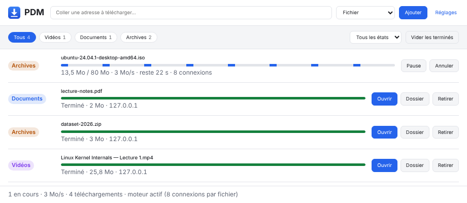
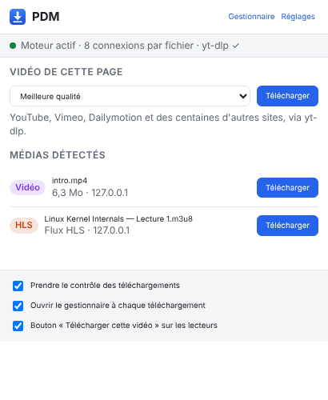
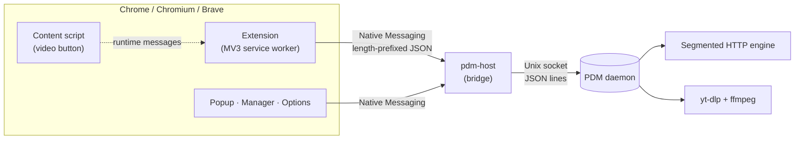

<div align="center">


# PDM — Download Manager for Chrome on Linux

**Multi-connection downloads, browser takeover and one-click video grabbing,
in the spirit of Internet Download Manager — for Chrome, Chromium, Brave, Edge and Vivaldi on Linux.**

[](https://github.com/dbvrnylh/pdm-download-manager/actions/workflows/ci.yml)
[](LICENSE)


[Français](README.fr.md) · [Changelog](CHANGELOG.md)

<picture>
  <source media="(prefers-color-scheme: dark)" srcset="docs/screenshots/manager-dark.png">
  
</picture>

</div>

## Highlights

- **Faster downloads.** Up to 32 connections per file with dynamic segmentation: when a connection finishes,
  it splits the largest remaining segment and takes half of it, so no connection sits idle until the end.
- **Takes over the browser's downloads** — safely. The engine probes the file first; if the server refuses it
  (login page, one-time link…), Chrome simply carries on. A download is never lost.
- **Pause, resume, survive.** Progress is persisted per segment: downloads resume after a network drop,
  a browser restart or a reboot. The engine keeps downloading when the browser is closed.
- **Videos in one click.** A "download this video" button appears on players; the popup lists detected media;
  YouTube and hundreds of sites are supported through [yt-dlp](https://github.com/yt-dlp/yt-dlp), with quality
  presets (best, 1080p, 720p, MP3). HLS/DASH streams are merged into a single MP4.
- **Organized.** Files are sorted into `Videos/`, `Musique/`, `Documents/`, `Archives/`, `Programmes/`,
  `Images/` and `Autres/`. Download queue, desktop notifications, right-click "Télécharger avec PDM".
- **No dependencies to install** for the engine: Python standard library only. Light and dark themes.

> The user interface is currently in French.

## Contents

- [Quick start](#quick-start)
- [Usage](#usage)
- [How it works](#how-it-works)
- [Configuration](#configuration)
- [FAQ](#faq)
- [Troubleshooting](#troubleshooting)
- [Privacy & security](#privacy--security)
- [Development](#development)
- [Roadmap](#roadmap)
- [Uninstall](#uninstall)

## Quick start

**Requirements:** Linux, a Chromium-based browser (Chrome 116+), Python 3.10+.
Recommended: `ffmpeg` (merging video + audio, MP3) and `libnotify-bin` (notifications).

```bash
git clone https://github.com/dbvrnylh/pdm-download-manager.git
cd pdm-download-manager
./install.sh            # no sudo: everything goes into your home directory
```

The installer copies the engine to `~/.local/share/pdm`, registers it with every Chromium-based browser it finds,
and offers to install PDM's own, always up-to-date copy of yt-dlp (answer **yes**).

Then load the extension:

1. Open `chrome://extensions` (`brave://extensions`, `edge://extensions`…).
2. Turn on **Developer mode**.
3. Click **Load unpacked** and select the `extension/` folder of this repository.
4. Open PDM → **Réglages**: you should read **"Moteur PDM 2.0.4 actif"**.

Keep the repository where it is: the browser loads the extension from it.

## Usage

| I want to… | How |
|---|---|
| Download a file | Click the link as usual — PDM takes over and opens its manager. |
| Download a video | Hover the player → **Télécharger cette vidéo**. |
| Pick the quality | PDM icon → **Vidéo de cette page** → choose a preset → **Télécharger**. |
| Grab a specific media file | PDM icon → **Médias détectés**, or right-click a link → **Télécharger avec PDM**. |
| Add a URL by hand | Manager → paste the address → **Fichier** or **Vidéo de la page** → **Ajouter**. |
| Download a list of links | Manager → **Importer une liste…**, or `pdm-host add --file links.txt`. See [below](#downloading-a-list-of-links). |
| Use the terminal | `~/.local/share/pdm/app/pdm-host add URL` (`--video` to go through yt-dlp). |

If a heavily protected site refuses the engine, **Avec Chrome** retries the download in the browser,
with the browser's own session.

<table>
  <tr>
    <td width="50%">
      <picture>
        <source media="(prefers-color-scheme: dark)" srcset="docs/screenshots/popup-dark.png">
        
      </picture>
    </td>
    <td width="50%">
      
      <br><br>
      <b>Popup</b> — engine status, one-click download of the page's video (with quality presets) and every media file
      detected on the page.
      <br><br>
      <b>Video button</b> — appears when hovering a player, isolated in a closed Shadow DOM so it never breaks the
      site's layout.
    </td>
  </tr>
</table>

### Downloading a list of links

To grab many files at once, prepare a text file with **one link per line**:

```text
# Networking course (lines starting with # are ignored)
https://example.org/course/chapter-1.pdf
https://example.org/course/chapter-2.pdf

https://example.org/course/appendix.zip
```

Then either:

- **Manager** → **Importer une liste…** → **Charger un fichier .txt…** (or paste the links into the box) →
  **Fichier** or **Vidéo de la page** → **Ajouter N téléchargements**.
- **Terminal**: `~/.local/share/pdm/app/pdm-host add --file links.txt` (`--video` for video pages,
  `--file -` to read standard input).

What actually happens:

1. **PDM reads the list and shows you how it understood it** before adding anything: the links it kept,
   duplicates, links already in the manager, and every rejected line with its number and the reason
   (`il manque https:// au début`, `un seul lien par ligne`…).
2. **Each link becomes a queued download**, in the order of the list. Nothing special happens in the engine:
   it is the same as adding the links one by one by hand.
3. **The queue does the rest.** PDM downloads as many files at once as the **Téléchargements simultanés**
   setting (3 by default); as soon as one finishes, the next one starts. It keeps going with the browser
   closed, and resumes after a reboot.
4. **A failing link doesn't stop the others.** It shows up as failed in the manager, with **Réessayer**.

Good to know:

- Importing the same list again only adds the new links: those already in the manager are skipped, even failed
  ones (use **Réessayer**). To download a finished file again, **remove** it from the manager first.
- The type (**Fichier** or **Vidéo de la page**) applies to the whole list. To mix direct files and YouTube
  pages, import twice. A video page imported as **Fichier** fails with "page web reçue au lieu d'un fichier"
  (a web page instead of a file): nothing is saved, import it again as **Vidéo de la page**.
- From the manager, PDM forwards each site's cookies (members-only files…). From the terminal it has no access
  to the browser: no cookies.
- At most 200 links per import and 1 MB for the file: split a longer list. The manager only shows the last 300
  downloads; beyond that, the start of the list would scroll out of view.
- The engine must be installed: without it there is no queue, and Chrome would start everything at once.

## How it works



**Why a daemon?** Chrome kills a native messaging host as soon as the extension disconnects. The host is
therefore a tiny bridge, and the real work happens in an independent daemon (one per user, guarded by a
lock file). Several pages can talk to it at once, it survives the browser, and it exits on its own after
ten minutes without work.

**Taking over a download.** Chrome asks extensions where to save each new file (`downloads.onDeterminingFilename`)
and cannot finish the download until it gets an answer. PDM uses that window to hand the URL to the engine,
along with the page's cookies and referrer. The engine sends a probe request: if it gets the actual file,
Chrome's download is cancelled and the engine takes over; if it gets an error or an HTML page, Chrome keeps going.

**Segmented downloading.**

1. The probe asks for `Range: bytes=0-`. A `206 Partial Content` answer proves the server supports ranges,
   and `Content-Range` gives the total size.
2. The file is preallocated, then split into segments. Each connection requests its range and writes at its
   offset with `os.pwrite`; the probe's connection is reused as the first one.
3. When the server provides an `ETag` or `Last-Modified`, every range request carries `If-Range`, so a file that
   changes on the server is detected instead of silently corrupted. Servers that answer inconsistently get a
   single-connection fallback.
4. Segment state is saved every two seconds: pause, crash or reboot, each segment resumes where it stopped.

**Videos.** yt-dlp knows how to read streaming playlists, choose a quality and merge audio with video.
PDM drives it as a subprocess and parses its progress line by line. PDM keeps its own copy of the official
yt-dlp build — which bundles the JavaScript challenge solver YouTube now requires — and updates it daily.

## Configuration

Everything lives in the extension's **Réglages** page:

| Setting | Default | Notes |
|---|---|---|
| Download folder | your XDG Downloads folder | Detected with `xdg-user-dir`. |
| Connections per file | 8 | 1–32. More only helps when a server throttles each connection. |
| Simultaneous downloads | 3 | 1–10; the rest waits in the queue. |
| Sort by category | on | `Videos/`, `Musique/`, `Archives/`… (ASCII folder names on purpose). |
| Desktop notifications | on | Needs `notify-send`. |
| Auto-resume | on | Restarts interrupted downloads when the engine starts. |
| Take over browser downloads · Open manager · Video button | on | Browser-side settings. |

Engine settings are stored in `~/.local/share/pdm/config.json`.

## FAQ

**How does it compare to IDM?**
Same core idea — segmented, resumable downloads driven from the browser — with the same limits: no external
program can reuse the connection the browser already opened, so one-time links and anti-bot checks based on the
browser's TLS fingerprint can't be taken over. When the engine's probe is refused, PDM leaves the download to
Chrome automatically; if a server refuses the engine later on, **Avec Chrome** retries it in the browser.
IDM's equivalent is its per-site exception list.

**Why do YouTube videos use a single connection?**
Because it is the fastest option: YouTube already serves one connection at full speed. Measured on a home
connection: **23.4 MiB/s** with one connection versus **17.3 MiB/s** with 8 parallel HLS fragments.
Multiple connections only pay off when a server throttles each connection — that's where PDM's segmentation
shines.

**Can it download from Netflix, Spotify, Disney+…?**
No. That content is protected by DRM, and circumventing technical protection measures is illegal in many
countries (in the EU under Directive 2001/29/EC, implemented in France by the DADVSI law). PDM does not try.

**Does it keep downloading when I close the browser?**
Yes. The daemon is independent from the browser; reopen the manager to see the results.

**Firefox?** Not yet — see the [roadmap](#roadmap).

## Troubleshooting

| Symptom | Fix |
|---|---|
| "moteur PDM non installé" | Run `./install.sh` again, then reload the options page. |
| The options page shows an old engine version | You ran an old `install.sh`; run the one from this repository. |
| A YouTube video fails (403…) | Check that yt-dlp is the "copie PDM" in **Réglages**; if not, run `./install.sh` and accept it. Install [deno](https://deno.com) (or node) for full YouTube support. |
| The video button doesn't appear | Players smaller than 240×135 px are ignored (thumbnails, ads). |
| Chromium as a snap or Flatpak | Their sandbox may block native messaging; prefer a `.deb`/native package. |

Engine status: `~/.local/share/pdm/app/pdm-host status` · Log: `~/.local/share/pdm/engine.log`
(includes the full yt-dlp output of failed video downloads).

## Privacy & security

- **No telemetry, no server.** Everything runs locally; nothing is sent anywhere except the downloads themselves.
- **Only this extension can start the engine:** the native host manifest allows a single extension ID,
  pinned by the public key in `manifest.json`.
- **Cookies stay scoped.** They are forwarded to the engine only for the download's site and are stripped when a
  redirect leaves that host. The job list that stores them (`jobs.json`) is readable by your user only (`0600`),
  and the daemon's Unix socket is private to your user.
- **Hostile input is treated as such:** file names are sanitized, page content is never injected with `innerHTML`,
  and yt-dlp is called with an argument list (no shell) after `--`.
- **Private browsing** downloads are never taken over.

## Development

```
extension/                 Chrome extension (Manifest V3, ES modules, no build step)
  background.js            service worker: media detection, takeover, context menus
  content/grab.js          video button (closed Shadow DOM)
  lib/                     engine client, media detection, file names, settings…
  popup/ manager/ options/ user interface
engine/
  pdm-host                 entry point (bridge, daemon, CLI)
  pdm_engine/              httpdl.py (segmented HTTP) · ytdlp.py · engine.py (queue, persistence)
                           daemon.py (Unix socket) · host.py (Native Messaging bridge)
tests/                     Python integration tests against a local HTTP server, Node unit tests
install.sh · uninstall.sh
```

Run the tests:

```bash
python3 -m unittest discover -s tests -v   # engine, daemon, bridge, yt-dlp (≈ 1 min)
node --test tests/lib.test.mjs             # extension modules
npx eslint extension                       # lint
```

The Python suite spins up a real HTTP server that simulates range support, per-connection throttling,
dropped connections, files changing mid-download, unstable ETags and cross-host redirects, then checks the
SHA-256 of every downloaded file. The yt-dlp tests generate their own HLS stream with ffmpeg; they are skipped
when yt-dlp or ffmpeg is missing. CI runs everything on every push.

Design choices worth knowing:

- **Standard library only** for the engine: nothing to `pip install`, works with the system Python.
- **No build step** for the extension: plain ES modules, loadable as-is.
- **One writer per resource:** async read-modify-write on `chrome.storage` is serialized; engine state is
  protected by locks acquired in a fixed order (`save_lock → lock → per-download lock`).

## Roadmap

- Replay every header the browser sent (not just cookies and referrer), IDM-style.
- Adapt to servers that limit the number of connections instead of failing.
- Automatic hand-back to Chrome with a per-site exception list.
- English interface.
- Firefox support and distribution packages (`.deb`, AUR).

## Uninstall

```bash
./uninstall.sh          # keeps history and settings
./uninstall.sh --purge  # also removes history, settings and PDM's yt-dlp copy
```

Then remove the extension from `chrome://extensions`. Downloaded files are never touched.

## Legal

PDM is a general-purpose download tool. Only download content you have the right to download, and respect the
terms of service of the sites you use. PDM does not circumvent DRM.

## License

[MIT](LICENSE) © 2026 Pablo Raudiel Ramos Cabrera

Built on the shoulders of [yt-dlp](https://github.com/yt-dlp/yt-dlp) and [FFmpeg](https://ffmpeg.org/).
